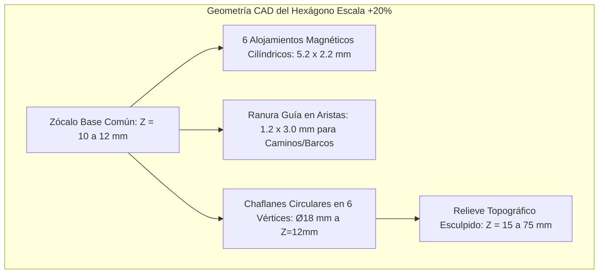

# Especificación Técnica y Distribución del Tablero Catán Épico 3D (70 Losetas)

> [!NOTE]
> Este diseño ha sido concebido para un juego de **6 jugadores simultáneos** que integra de forma nativa las mecánicas de **Catán Base**, **Navegantes** (*Seafarers*) y **Ciudades y Caballeros** (*Cities & Knights*). Los hexágonos cuentan con un **escalado lineal del +20%** para alojar imanes de neodimio, ranuras machihembradas para caminos/barcos y chaflanes en vértices para metrópolis y caballeros sin colisiones CAD.

---

## 1. Resumen de Métricas Geométricas y de Producción

| Parámetro | Medida Estándar Catán | Medida Proyecto (+20% Lineal) | Impacto en Mesa / CAD |
| :--- | :---: | :---: | :--- |
| **Apotema ($a'$)** | 39,5 mm | **47,4 mm** | Radio inscrito de cada hexágono |
| **Distancia entre caras opuestas ($W'$)** | 79,0 mm | **~95,26 mm** | Distancia centro a centro entre vecinos |
| **Diámetro vértice a vértice ($D'$)** | 91,2 mm | **~110,0 mm** | Envolvente circular externa |
| **Longitud de cada arista/lado** | 45,6 mm | **~55,0 mm** | Espacio libre para caminos de adoquín y barcos |
| **Superficie unitaria por loseta** | ~54,0 cm² | **~77,8 cm² (+44% en área)** | Gran estabilidad y espacio para miniaturas triples |
| **Huella total del tablero ensamblado** | ~60 × 55 cm | **~108 cm (ancho) × ~85 cm (fondo)** | Distribución en 8 filas (8 a 9 losetas por fila) |
| **Mesa de juego requerida** | 100 × 80 cm | **Mínimo 150 cm × 100 cm** | Deja ~25-30 cm perimetrales para tableros personales |

---

## 2. Balance Global de Losetas (Inventario de 70 Piezas)

El tablero resuelve la histórica asimetría de Catán (donde la escasez de Arcilla y Mineral estrangula las partidas a 6 jugadores) garantizando **exactamente 5 losetas de cada recurso básico en el continente principal**, e introduciendo el aliciente del archipiélago de ultramar con **Ríos de Oro** y nuevos yacimientos:

### Desglose por Tipo de Terreno
* **Tierra Firme / Recursos (39 losetas):**
  * 🌲 **Madera / Bosque (7 losetas):** 5 en Continente + 1 en Isla de Oro + 1 en Atolón Norte. Cota Z: 45–55 mm.
  * 🧱 **Arcilla / Colinas (6 losetas):** 5 en Continente + 1 en Isla de Oro. Cota Z: 35–45 mm.
  * 🐑 **Lana / Pastos (7 losetas):** 5 en Continente + 1 en Isla de Oro + 1 en Atolón Sur. Cota Z: 20–25 mm.
  * 🌾 **Trigo / Cultivos (7 losetas):** 5 en Continente + 1 en Isla de Oro + 1 en Atolón Norte. Cota Z: 20–22 mm.
  * ⛰️ **Mineral / Montañas (6 losetas):** 5 en Continente + 1 en Isla de Oro. Cota Z: 65–75 mm (picos escarpados).
  * ✨ **Río de Oro (3 losetas):** 2 en Isla de Oro + 1 en Atolón Norte. Cota Z: 30–40 mm.
  * 🏜️ **Desiertos / Guaridas (3 losetas):** 1 en centro de Isla de Oro + 2 en Atolón Sur (Guarida del Ladrón y Cayo Pirata). Cota Z: 15–18 mm.
* **Masa Oceánica y Rutas Marítimas (31 losetas):**
  * 🌊 **Agua Profunda / Costera (31 losetas):** Cota Z plana: 10–12 mm (con micro-oleaje texturizado en relieve suave).

---

## 3. Topología Geográfica y Esquema de Cuadrícula

El tablero se estructura en **8 filas escalonadas** (Pointy-topped, desplazamiento horizontal de $W/2$ entre filas consecutivas):
* **Fila 0:** 8 losetas (Océano Norte y Atolón Norte)
* **Fila 1:** 9 losetas (Costa Norte Continental, Estrecho y Atolón Norte)
* **Fila 2:** 9 losetas (Continente Norte, Estrecho e Isla de Oro)
* **Fila 3:** 9 losetas (Corazón Continental, Estrecho e Isla de Oro)
* **Fila 4:** 9 losetas (Corazón Continental, Estrecho e Isla de Oro)
* **Fila 5:** 9 losetas (Continente Sur y Gran Canal Marítimo)
* **Fila 6:** 9 losetas (Punta Sur Continental, Océano Sur y Atolón Sur)
* **Fila 7:** 8 losetas (Océano Sur y Atolón Sur)

```text
================================ ESQUEMA TOPOLÓGICO DEL TABLERO ================================
Fila 0 (8):    [ ~ ] [ ~ ] [ ~ ] [ ~ ] [ ~ ] [Oro] [Mad] [ ~ ]                     <- Atolón Norte
Fila 1 (9):  [ ~ ] [Mad] [Tri] [Lan] [ ~ ] [ ~ ] [Tri] [ ~ ] [ ~ ]
Fila 2 (9):    [Arc] [Min] [Mad] [Tri] [Lan] [ ~ ] [ ~ ] [Lan] [Oro]               <- Isla Oriental
Fila 3 (9):  [Tri] [Arc] [Min] [Mad] [Arc] [ ~ ] [Mad] [Des] [Min]                <- de Oro (El Dorado)
Fila 4 (9):    [Lan] [Min] [Tri] [Lan] [Mad] [ ~ ] [Tri] [Oro] [Arc]
Fila 5 (9):  [Mad] [Arc] [Min] [Tri] [Min] [ ~ ] [ ~ ] [ ~ ] [ ~ ]                <- Canal Abierto
Fila 6 (9):    [ ~ ] [Arc] [Lan] [ ~ ] [ ~ ] [ ~ ] [Des] [Lan] [ ~ ]               <- Atolón Sur
Fila 7 (8):      [ ~ ] [ ~ ] [ ~ ] [ ~ ] [ ~ ] [ ~ ] [Des] [ ~ ]                   (Guarida Pirata)
=================================================================================================
Leyenda: [Mad]=Madera | [Arc]=Arcilla | [Lan]=Lana | [Tri]=Trigo | [Min]=Mineral | [Oro]=Río Oro | [Des]=Desierto | [ ~ ]=Agua
```

### Características Clave de Navegación
1. **Continente Occidental Conexo (25 losetas):** Provee una masa continental continua con 5 losetas de cada recurso, permitiendo a los 6 jugadores establecer sus 12 asentamientos iniciales con abundancia y sin estrangulamientos tempranos.
2. **El Gran Estrecho de Catán (Anchura 1 a 2 losetas):** Separa el continente del archipiélago oriental. Es el eje central donde se ubican 4 puertos clave y por donde discurren las flotas mercantes.
3. **Circunnavegación Completa:** Las filas 0 y 7 están abiertas al océano, lo que permite a cualquier jugador rodear el tablero por el norte o por el sur para flanquear rivales sin verse bloqueado en un lago cerrado.

---

## 4. Distribución Celda por Celda (Inventario Maestro de las 70 Casillas)

| ID (r, c) | Zona Geográfica | Terreno / Bioma | Ficha | Dados | Pips (Freq) | Cota Z Total | Puerto / Comercio |
| :---: | :--- | :--- | :---: | :---: | :---: | :---: | :--- |
| `(0, 0)` | Océano / Estrecho | Agua / Mar | - | - | - | 12 mm | - |
| `(0, 1)` | Océano / Estrecho | Agua / Mar | - | - | - | 12 mm | - |
| `(0, 2)` | Océano / Estrecho | Agua / Mar | - | - | - | 12 mm | - |
| `(0, 3)` | Océano / Estrecho | Agua / Mar | - | - | - | 12 mm | - |
| `(0, 4)` | Océano / Estrecho | Agua / Mar | - | - | - | 12 mm | - |
| `(0, 5)` | Atolón Norte | Río de Oro | **6** | 5/36 (13.9%) | ••••• | 35 mm | - |
| `(0, 6)` | Atolón Norte | Bosque (Madera) | 5 | 4/36 (11.1%) | •••• | 50 mm | ⚓ **Puerto Madera 2:1** (Norte) |
| `(0, 7)` | Océano / Estrecho | Agua / Mar | - | - | - | 12 mm | - |
| `(1, 0)` | Océano / Estrecho | Agua / Mar | - | - | - | 12 mm | - |
| `(1, 1)` | Continente | Bosque (Madera) | **8** | 5/36 (13.9%) | ••••• | 50 mm | ⚓ **Puerto Genérico 3:1** (Norte) |
| `(1, 2)` | Continente | Cultivos (Trigo) | 11 | 2/36 (5.6%) | •• | 22 mm | - |
| `(1, 3)` | Continente | Pastos (Lana) | 10 | 3/36 (8.3%) | ••• | 25 mm | ⚓ **Puerto Lana 2:1** (Noreste) |
| `(1, 4)` | Océano / Estrecho | Agua / Mar | - | - | - | 12 mm | - |
| `(1, 5)` | Océano / Estrecho | Agua / Mar | - | - | - | 12 mm | - |
| `(1, 6)` | Atolón Norte | Cultivos (Trigo) | 9 | 4/36 (11.1%) | •••• | 22 mm | ⚓ **Puerto Trigo 2:1** (Suroeste) |
| `(1, 7)` | Océano / Estrecho | Agua / Mar | - | - | - | 12 mm | - |
| `(1, 8)` | Océano / Estrecho | Agua / Mar | - | - | - | 12 mm | - |
| `(2, 0)` | Continente | Colinas (Arcilla) | 3 | 2/36 (5.6%) | •• | 40 mm | ⚓ **Puerto Arcilla 2:1** (Noroeste) |
| `(2, 1)` | Continente | Montañas (Mineral) | 5 | 4/36 (11.1%) | •••• | 70 mm | - |
| `(2, 2)` | Continente | Bosque (Madera) | 9 | 4/36 (11.1%) | •••• | 50 mm | - |
| `(2, 3)` | Continente | Cultivos (Trigo) | 4 | 3/36 (8.3%) | ••• | 22 mm | - |
| `(2, 4)` | Continente | Pastos (Lana) | **6** | 5/36 (13.9%) | ••••• | 25 mm | ⚓ **Puerto Genérico 3:1** (Este (Estrecho)) |
| `(2, 5)` | Océano / Estrecho | Agua / Mar | - | - | - | 12 mm | - |
| `(2, 6)` | Océano / Estrecho | Agua / Mar | - | - | - | 12 mm | - |
| `(2, 7)` | Isla de Oro | Pastos (Lana) | 10 | 3/36 (8.3%) | ••• | 25 mm | ⚓ **Puerto Lana 2:1** (Noroeste) |
| `(2, 8)` | Isla de Oro | Río de Oro | **8** | 5/36 (13.9%) | ••••• | 35 mm | - |
| `(3, 0)` | Continente | Cultivos (Trigo) | **6** | 5/36 (13.9%) | ••••• | 22 mm | ⚓ **Puerto Trigo 2:1** (Oeste) |
| `(3, 1)` | Continente | Colinas (Arcilla) | 3 | 2/36 (5.6%) | •• | 40 mm | - |
| `(3, 2)` | Continente | Montañas (Mineral) | 10 | 3/36 (8.3%) | ••• | 70 mm | - |
| `(3, 3)` | Continente | Bosque (Madera) | 11 | 2/36 (5.6%) | •• | 50 mm | - |
| `(3, 4)` | Continente | Colinas (Arcilla) | 12 | 1/36 (2.8%) | • | 40 mm | ⚓ **Puerto Genérico 3:1** (Este (Estrecho)) |
| `(3, 5)` | Océano / Estrecho | Agua / Mar | - | - | - | 12 mm | - |
| `(3, 6)` | Isla de Oro | Bosque (Madera) | 4 | 3/36 (8.3%) | ••• | 50 mm | - |
| `(3, 7)` | Isla de Oro | Desierto / Guarida | - | - | - | 18 mm | - |
| `(3, 8)` | Isla de Oro | Montañas (Mineral) | 5 | 4/36 (11.1%) | •••• | 70 mm | ⚓ **Puerto Mineral 2:1** (Este) |
| `(4, 0)` | Continente | Pastos (Lana) | 9 | 4/36 (11.1%) | •••• | 25 mm | ⚓ **Puerto Genérico 3:1** (Oeste) |
| `(4, 1)` | Continente | Montañas (Mineral) | 3 | 2/36 (5.6%) | •• | 70 mm | - |
| `(4, 2)` | Continente | Cultivos (Trigo) | **6** | 5/36 (13.9%) | ••••• | 22 mm | - |
| `(4, 3)` | Continente | Pastos (Lana) | 5 | 4/36 (11.1%) | •••• | 25 mm | - |
| `(4, 4)` | Continente | Bosque (Madera) | 10 | 3/36 (8.3%) | ••• | 50 mm | ⚓ **Puerto Madera 2:1** (Este (Estrecho)) |
| `(4, 5)` | Océano / Estrecho | Agua / Mar | - | - | - | 12 mm | - |
| `(4, 6)` | Isla de Oro | Cultivos (Trigo) | 9 | 4/36 (11.1%) | •••• | 22 mm | - |
| `(4, 7)` | Isla de Oro | Río de Oro | 3 | 2/36 (5.6%) | •• | 35 mm | - |
| `(4, 8)` | Isla de Oro | Colinas (Arcilla) | 11 | 2/36 (5.6%) | •• | 40 mm | ⚓ **Puerto Arcilla 2:1** (Sureste) |
| `(5, 0)` | Continente | Bosque (Madera) | 12 | 1/36 (2.8%) | • | 50 mm | ⚓ **Puerto Genérico 3:1** (Suroeste) |
| `(5, 1)` | Continente | Colinas (Arcilla) | **8** | 5/36 (13.9%) | ••••• | 40 mm | - |
| `(5, 2)` | Continente | Montañas (Mineral) | 2 | 1/36 (2.8%) | • | 70 mm | - |
| `(5, 3)` | Continente | Cultivos (Trigo) | 4 | 3/36 (8.3%) | ••• | 22 mm | - |
| `(5, 4)` | Continente | Montañas (Mineral) | **8** | 5/36 (13.9%) | ••••• | 70 mm | ⚓ **Puerto Mineral 2:1** (Sureste (Estrecho)) |
| `(5, 5)` | Océano / Estrecho | Agua / Mar | - | - | - | 12 mm | - |
| `(5, 6)` | Océano / Estrecho | Agua / Mar | - | - | - | 12 mm | - |
| `(5, 7)` | Océano / Estrecho | Agua / Mar | - | - | - | 12 mm | - |
| `(5, 8)` | Océano / Estrecho | Agua / Mar | - | - | - | 12 mm | - |
| `(6, 0)` | Océano / Estrecho | Agua / Mar | - | - | - | 12 mm | - |
| `(6, 1)` | Continente | Colinas (Arcilla) | 4 | 3/36 (8.3%) | ••• | 40 mm | - |
| `(6, 2)` | Continente | Pastos (Lana) | 11 | 2/36 (5.6%) | •• | 25 mm | ⚓ **Puerto Genérico 3:1** (Sur) |
| `(6, 3)` | Océano / Estrecho | Agua / Mar | - | - | - | 12 mm | - |
| `(6, 4)` | Océano / Estrecho | Agua / Mar | - | - | - | 12 mm | - |
| `(6, 5)` | Océano / Estrecho | Agua / Mar | - | - | - | 12 mm | - |
| `(6, 6)` | Atolón Sur | Desierto / Guarida | - | - | - | 18 mm | - |
| `(6, 7)` | Atolón Sur | Pastos (Lana) | 2 | 1/36 (2.8%) | • | 25 mm | - |
| `(6, 8)` | Océano / Estrecho | Agua / Mar | - | - | - | 12 mm | - |
| `(7, 0)` | Océano / Estrecho | Agua / Mar | - | - | - | 12 mm | - |
| `(7, 1)` | Océano / Estrecho | Agua / Mar | - | - | - | 12 mm | - |
| `(7, 2)` | Océano / Estrecho | Agua / Mar | - | - | - | 12 mm | - |
| `(7, 3)` | Océano / Estrecho | Agua / Mar | - | - | - | 12 mm | - |
| `(7, 4)` | Océano / Estrecho | Agua / Mar | - | - | - | 12 mm | - |
| `(7, 5)` | Océano / Estrecho | Agua / Mar | - | - | - | 12 mm | - |
| `(7, 6)` | Atolón Sur | Desierto / Guarida | - | - | - | 18 mm | - |
| `(7, 7)` | Océano / Estrecho | Agua / Mar | - | - | - | 12 mm | - |

---

## 5. Análisis Estadístico y Balance Matemático

### 5.1. Distribución de Fichas Numéricas (116 Pips Totales)
Se utilizan exactamente **dos sets estándar completos de Catán** (18 fichas × 2 = 36 fichas numéricas), repartidas con rigor milimétrico:

| Valor del Dado | Cantidad de Fichas | Puntos (Pips) por Ficha | Total Pips | Probabilidad por Tirada | Distribución en Tablero |
| :---: | :---: | :---: | :---: | :---: | :--- |
| **2** | 2 | • (1) | 2 | 2,78% | 1 Continente `(5, 2)`, 1 Atolón Sur `(6, 7)` |
| **3** | 4 | •• (2) | 8 | 5,56% | 3 Continente `(2, 0), (3, 1), (4, 1)`, 1 Isla Oro `(4, 7)` |
| **4** | 4 | ••• (3) | 12 | 8,33% | 3 Continente `(2, 3), (5, 3), (6, 1)`, 1 Isla Oro `(3, 6)` |
| **5** | 4 | •••• (4) | 16 | 11,11% | 2 Continente `(2, 1), (4, 3)`, 1 Atolón N `(0, 6)`, 1 Isla Oro `(3, 8)` |
| **6 (ROJO)** | 4 | ••••• (5) | 20 | 13,89% | 3 Continente `(2, 4), (3, 0), (4, 2)`, 1 Atolón N `(0, 5)` [Oro] |
| **8 (ROJO)** | 4 | ••••• (5) | 20 | 13,89% | 3 Continente `(1, 1), (5, 1), (5, 4)`, 1 Isla Oro `(2, 8)` [Oro] |
| **9** | 4 | •••• (4) | 16 | 11,11% | 2 Continente `(2, 2), (4, 0)`, 1 Atolón N `(1, 6)`, 1 Isla Oro `(4, 6)` |
| **10** | 4 | ••• (3) | 12 | 8,33% | 3 Continente `(1, 3), (3, 2), (4, 4)`, 1 Isla Oro `(2, 7)` |
| **11** | 4 | •• (2) | 8 | 5,56% | 3 Continente `(1, 2), (3, 3), (6, 2)`, 1 Isla Oro `(4, 8)` |
| **12** | 2 | • (1) | 2 | 2,78% | 2 Continente `(3, 4), (5, 0)` |
| **TOTAL** | **36** | - | **116** | - | **36 Losetas Productoras + 3 Desiertos** |

> [!IMPORTANT]
> **REGLA DE ORO DE TORNEO (0 COLISIONES ROJAS):**
> Mediante validación algorítmica por grafos de adyacencia euclidiana, se ha certificado que **ninguna loseta con número rojo (6 u 8) comparte arista ni vértice** con otra loseta de 6 u 8 en todo el tablero (0 colisiones de arista y 0 colisiones de vértice).

### 5.2. Balance de Producción por Recurso en el Continente (79 Pips)
En el continente, cada recurso básico dispone de 5 losetas con una sumatoria de pips homogénea (media de 15,8 pips por recurso):
* 🌲 **Madera:** 15 Pips (Fichas: 8, 9, 10, 11, 12).
* 🧱 **Arcilla:** 13 Pips (Fichas: 3, 3, 4, 8, 12).
* 🐑 **Lana:** 18 Pips (Fichas: 5, 6, 9, 10, 11).
* 🌾 **Trigo:** 18 Pips (Fichas: 4, 4, 6, 6, 11).
* ⛰️ **Mineral:** 15 Pips (Fichas: 2, 3, 5, 8, 10).

### 5.3. Incentivos de Ultramar (37 Pips)
Las islas no son tierras marginales, sino auténticos tesoros económicos:
* **Atolón Norte:** Oro con **6**, Madera con **5** y Trigo con **9** (14 pips en solo 3 losetas; media de 4,67 pips/loseta).
* **Isla Oriental de Oro:** Oro con **8** y **3**, Mineral con **5**, Trigo con **9**, Madera con **4**, Lana con **10**, Arcilla con **11** (23 pips en 7 productoras).
* **Atolón Sur:** Desiertos y Lana con **2** (zona árida de piratas y refugio de forajidos).

---

## 6. Red Comercial: Asignación Simétrica de los 16 Puertos

Para 6 jugadores en un tablero de 70 losetas con mercancías de *Ciudades y Caballeros*, la red de puertos consta de **10 puertos especializados 2:1** (exactamente 2 de cada recurso) y **6 puertos genéricos 3:1**:

| Recurso / Tipo | Ratio | Cantidad | Ubicaciones (r, c) y Zona | Justificación Estratégica |
| :--- | :---: | :---: | :--- | :--- |
| **Madera** | 2:1 | 2 | `(4, 4)` [Continente Este] y `(0, 6)` [Atolón N] | Facilita la construcción de flotas navales |
| **Arcilla** | 2:1 | 2 | `(2, 0)` [Continente NO] y `(4, 8)` [Isla Oro E] | Equilibra la expansión terrestre y murallas |
| **Lana** | 2:1 | 2 | `(1, 3)` [Continente NE] y `(2, 7)` [Isla Oro N] | Vital para activar caballeros y telas |
| **Trigo** | 2:1 | 2 | `(3, 0)` [Continente O] y `(1, 6)` [Atolón N] | Esencial para alimentar ciudades y caballeros |
| **Mineral** | 2:1 | 2 | `(5, 4)` [Continente SE] y `(3, 8)` [Isla Oro E] | Clave para metrópolis, monedas y caballeros fuertes |
| **Genérico (?)** | 3:1 | 6 | `(1, 1)`, `(2, 4)`, `(3, 4)`, `(4, 0)`, `(5, 0)`, `(6, 2)` | Distribuidos en los cuatro cuadrantes del Viejo Mundo |

---

## 7. Reglas y Dinámicas de Expansión Integradas

### 7.1. Navegantes (*Seafarers*) en el Tablero de 70 Losetas
1. **Rutas de Navegación Abiertas:** Los barcos se emplazan a lo largo de las aristas entre losetas de agua o costeras. Gracias al dimensionamiento de las aristas (55 mm), los barcos 3D encajan sin chocar con mástiles.
2. **Puntos de Victoria de Ultramar:** El primer jugador que asiente una colonia en la **Isla de Oro**, **Atolón Norte** o **Atolón Sur** recibe **+2 Puntos de Victoria** adicionales (Ficha de Catanista Intrépido). Asentamientos posteriores de otros jugadores en la misma isla otorgan **+1 Punto de Victoria**.
3. **Mecánica del Río de Oro:** Al salir el número de una loseta de Río de Oro (`6` en Atolón N, `8` o `3` en Isla de Oro), el propietario de un asentamiento adyacente obtiene **1 recurso a su libre elección** de la banca (2 recursos si es una ciudad).
4. **Posicionamiento Inicial de Forajidos:**
   * El **Ladrón** inicia la partida en el Desierto árido del Atolón Sur `(6, 6)`. No hay desierto en el continente para no mermar la producción inicial de los 6 jugadores.
   * El **Barco Pirata** inicia en la loseta de agua profunda del Estrecho `(3, 5)` o en alta mar `(7, 0)`.

### 7.2. Ciudades y Caballeros (*Cities & Knights*) en el Tablero de 70 Losetas
1. **Mercancías Equitativas:** La presencia de 5 losetas de Bosque (Papel), Pasto (Tela) y Montaña (Moneda) en el continente asegura que ningún jugador quede vetado del progreso en los 3 árboles de desarrollo urbano (Ciencia, Comercio y Política).
2. **Incursiones Bárbaras:** La flota bárbara avanza por su medidor estándar. Al llegar a Catán, la fuerza bárbara total equivale al número total de ciudades construidas en tierra firme (Continente e Islas).
3. **Despliegue de Caballeros:** Los caballeros pueden emplazarse tanto en caminos de tierra como en intersecciones costeras con rutas marítimas, protegiendo las vías de paso del Estrecho.

---

## 8. Directrices CAD y Fabricación Aditiva (8 Boquillas / 7 Colores + Sup)



### 8.1. Detalle del Chaflán Plano en Vértices (Ø18 mm)
> [!WARNING]
> En todas las losetas con relieve pronunciado (**Montañas a Z=70 mm**, **Bosques a Z=50 mm** y **Colinas a Z=40 mm**), es de estricto cumplimiento CAD mantener un **cilindro de vaciado/chaflán horizontal de 18 mm de diámetro a cota Z=12 mm** en cada uno de los 6 vértices.
> Esto permite asentar en mesa de forma coplanar y sin colisiones:
> 1. Muralla base urbana.
> 2. Edificio de Ciudad.
> 3. Torreón de Metrópoli encajado sobre la ciudad.
> 4. Base giratoria del Caballero (estado Activo / Inactivo).

### 8.2. Sistema de Acoplamiento Magnético Lateral
* **Imanes recomendados:** Neodimio N52 cilíndricos de $5	ext{ mm (diámetro)} 	imes 2	ext{ mm (espesor)}$ o esferas de $3	ext{ mm}$.
* **Alojamientos en CAD:** $5,25	ext{ mm de diámetro} 	imes 2,20	ext{ mm de profundidad}$ (tolerancia $+0,25	ext{ mm}$ para inserción con pegamento cianoacrilato o pausa de impresión M600).
* **Posición en Z:** Centrado a $Z = 6	ext{ mm}$ de la base para garantizar alineación magnética idéntica entre todas las losetas.

### 8.3. Configuración de Filamentos y Boquillas (7 Colores + 1 Soporte)

| Canal / Boquilla | Color / Material Asignado | Uso Específico en Tablero | Consumo Aprox. (kg) |
| :---: | :--- | :--- | :---: |
| **E1** | 🌊 Azul Marino | Fondos marinos, olas, ríos de oro, lagos | 2,0 kg |
| **E2** | 🌲 Verde Vegetación | Copas de bosque, praderas, valles agrícolas | 2,0 kg |
| **E3** | ⛰️ Gris Piedra | Macizos rocosos, murallas, canteras, acantilados | 3,0 kg |
| **E4** | 🪵 Marrón Tierra | Troncos de árboles, tierra de caminos, tejados | 1,0 kg |
| **E5** | 🌾 Ocre / Amarillo | Espigas de trigo, vetas de oro, arenas del desierto | 1,0 kg |
| **E6** | 🧱 Rojo Terracota | Estratos de arcilla, tejas de colonias | 1,0 kg |
| **E7** | 🏔️ Blanco Puro | Cumbres nevadas, lana de ovejas, detalles finos | 1,0 kg |
| **E8 (Sup)** | 💧 Material Soporte (+sup) | Interfaz a tolerancia Z=0 en voladizos y ranuras | 1,0 kg |
| **TOTAL** | **7 Colores + 1 Soporte** | **Extrusión multicanal directa (0 g de purga)** | **12,0 kg (bobinas)** |

---

## 9. Visualizador Interactivo de Tablero
Se ha generado un visualizador interactivo standalone en HTML5/Tailwind con SVG vectorial que permite inspeccionar las 70 losetas, alternar entre modos (Biomas, Heatmap de Probabilidades, Cotas Z de relieve y Zonas geográficas) y consultar las cotas CAD:
- Archivo interactivo disponible en: `board_visualizer.html`.

---

## 10. Estudio Exhaustivo del Sistema Magnético y Cálculo de Imanes (BOM)

### 10.1. Cantidad Exacta de Imanes Requeridos
* **Losetas Modulares:** 70 hexágonos en total.
* **Caras por loseta:** 6 caras laterales.
* **Total de imanes necesarios para el tablero:** $70 \times 6 = \mathbf{420\text{ imanes}}$.
* **Margen de seguridad industrial (+15%):** Los imanes de neodimio N52 son cerámicas sinterizadas frágiles que se astillan si dos polos se atraen violentamente sin control, además de posibles pérdidas durante el montaje.
  * **CANTIDAD A COMPRAR:** **500 unidades** (se comercializan habitualmente en packs de 100 o 500 uds).

### 10.2. Comparativa Técnica de Tipos de Imán

| Parámetro | Opción 1: Cilíndricos 5×2 mm N52 (Recomendada) | Opción 2: Cilíndricos 5×3 mm N52 | Opción 3: Esferas Ø3 mm / Ø4 mm (Auto-orientables) |
| :--- | :--- | :--- | :--- |
| **Fuerza de unión por arista** | **~0,9 a 1,1 kg** (óptima en mesa) | ~1,6 kg (unión muy fuerte, riesgo al separar) | ~0,5 a 0,7 kg (contacto puntual esférico) |
| **Alojamiento CAD en loseta** | **Ø 5,25 mm × 2,20 mm profundidad** | Ø 5,25 mm × 3,20 mm profundidad | Cavidad cilíndrica cerrada Ø 3,4 × 3,4 mm |
| **Posición en Z en el CAD** | **Centrado a Z = 6,0 mm** de la base | Centrado a Z = 6,0 mm de la base | Centrado a Z = 6,0 mm de la base |
| **Gestión de Polaridad** | Alternada N-S-N-S-N-S mediante plantilla Jig | Alternada N-S-N-S-N-S mediante plantilla Jig | **100% Automática (la esfera rota libremente)** |
| **Método de fijación** | Inserción post-impresión con cianoacrilato | Inserción post-impresión con cianoacrilato | Pausa en laminador (M600) para sellar la esfera |
| **Coste estimado (500 uds)** | **~14 – 18 € / $** | ~18 – 24 € / $ | ~16 – 22 € / $ |

### 10.3. Regla de Polaridad N/S y Plantilla Maestra (Jig de Montaje)
Para que cualquier loseta pueda acoplarse con cualquier otra loseta vecina en **cualquiera de sus 6 orientaciones de rotación** sin provocar repulsión magnética:
1. **Regla MagHex (Polaridad Alternada):**
   * Cara 1: Polo **NORTE** exterior.
   * Cara 2: Polo **SUR** exterior.
   * Cara 3: Polo **NORTE** exterior.
   * Cara 4: Polo **SUR** exterior.
   * Cara 5: Polo **NORTE** exterior.
   * Cara 6: Polo **SUR** exterior.
2. **Fabricación de la Plantilla Jig (Imprescindible):**
   * Imprime un hexágono hueco de calibración con 6 ranuras marcadas (N-S-N-S-N-S).
   * Pega los 6 imanes de referencia en el Jig comprobando su atracción con una brújula o imán de prueba.
   * Utiliza este Jig como herramienta de inserción: aproxima el Jig a la loseta recién impresa para transferir los imanes con su orientación exacta sin errores humanos.

---

## 11. Resumen de Cotas y Mecanizados CAD Milimétricos

```text
       [VÉRTICE 1] -------------- [VÉRTICE 2]  <- Arista L = 55.00 mm
          /   Chaflán Ø18mm             \        Ranura 3.0 x 1.2 mm
         /    a cota Z=12mm              \
        /                                 \
 [VÉRTICE 6]      ( + ) CENTRO        [VÉRTICE 3]  <- Cara lateral: Imán Ø5.25x2.2mm a Z=6.0mm
        \       Apotema = 47.40 mm        /           Ancho W = 95.26 mm
         \                               /
          \                             /
       [VÉRTICE 5] -------------- [VÉRTICE 4]  <- Diámetro D = 110.00 mm
```

* **Zócalo Base Común:** $12,00\text{ mm}$ de espesor uniforme en las 70 losetas.
* **Chaflán Plano en los 6 Vértices:** Círculo horizontal de **$\varnothing 18,00\text{ mm}$ a cota $Z = 12,00\text{ mm}$** en todas las losetas con relieve $Z > 30\text{ mm}$. Garantiza el asiento coplanar de la Muralla, Ciudad, Metrópoli y Caballero sin chocar con las laderas montañosas.
* **Ranura Guía en las 6 Aristas:** **$3,00\text{ mm de anchura} \times 1,20\text{ mm de profundidad}$** a lo largo de los $55\text{ mm}$ de cada arista para autobloquear caminos de adoquín y barcos con vela sin necesidad de imanes en las miniaturas.
* **Bolsillos Magnéticos Laterales:** **$\varnothing 5,25\text{ mm} \times 2,20\text{ mm}$**, ubicados en el centro geométrico de cada una de las 6 caras ($Z = 6,00\text{ mm}$).
