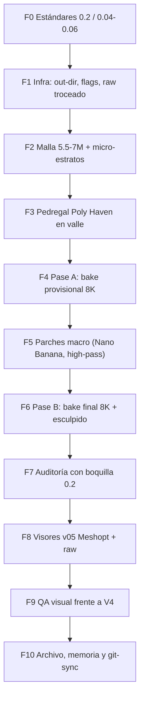

# Plan de ejecución — `montana_hero360` **v05-macro8k** (boquilla 0.2 mm / capa 0.04–0.06 mm)

> Ejecutor previsto: **Gemini 4 Hydrogen**. Redactado el 22/11/2026 a las 20:26 con métricas medidas sobre el disco.
> Copia persistente en el repo: `docs/ia/PLAN_montana_hero360_v05.md`.

---

## 0. Diagnóstico medido (punto de partida, no hace falta volver a medirlo)

| Métrica | v03/v04 (actual) | Fuente |
|---|---|---|
| Caras totales / terreno (`z > 25.08`) | `2,521,320` / `2,494,978` | `montana_hero360/tile_master.stl` (trimesh) |
| Superficie de terreno | `17,494 mm²` (total `39,773 mm²`) | trimesh |
| Arista media / p95 | `0.146 mm` / `0.2095 mm` | trimesh `edges_unique_length` |
| Densidad del atlas `4096²`, `52.2%` ocupado | **`22.4 px/mm`** | calculado |
| Densidad del atlas `8192²`, `75%` ocupado | **`53.6 px/mm`** | calculado |
| Información real de las cámaras fuente | **`~6.9 px/mm`** (`fov 15.68°`, distancia `~542 mm` → campo de `~149 mm` en `1024 px` de origen; `views_2k/` es solo un reescalado) | `cameras.json` |
| Malla de altura nativa `Z_hero360.npy` | `1024×1024` float32 (`4,194,432 B`) | disco |
| v03 Meshopt frente a v04 raw | **Visualmente idénticos** (lo confirmó el usuario) | — |

> [!IMPORTANT]
> **Conclusión:** el atlas 4K ya sobremuestrea unas **3×** la información que traen las cámaras. El techo de calidad lo pone **la información de la fuente**, no el atlas, ni la compresión, ni el número de triángulos. Por eso, si solo se sube a 8K o a 8M Δ sin **parches macro**, el resultado se verá **igual**. El salto de calidad sale de la Fase 5 (parches macro en "posición humana"), y la malla y el 8K son el recipiente necesario para guardarlo.
> Además, `nx_mesh=1024` coincide con la resolución nativa de `Z_hero360.npy`; pasar de ahí solo interpola. El detalle por encima de esa resolución tiene que salir del **esculpido** (Fases 2, 5 y 6).

---

## 1. Objetivos y criterios de aceptación

| Criterio | v04 | **Objetivo v05** |
|---|---|---|
| Caras de terreno | 2.49M | **5.5M–7M** (arista media ≤ `0.10 mm`, p95 ≤ `0.13 mm`) |
| Atlas del terreno | 4K, 52% | **8K, ≥ 75%** (≥ `50 px/mm`) |
| Detalle fuente efectivo | ~7 px/mm | **≥ 35 px/mm** en zonas cubiertas por parches; cobertura ≥ **85%** del área de terreno visible |
| Estanqueidad | OK | `repaired=false`, `watertight=true`, `χ=2`, `degenerate=0`, `non_manifold=0`, `1` componente |
| Interfaz Catán | OK | `110.85×128 mm`, `6/6` pads a `25.0 mm`, imán `Ø10.20×5.20 mm` |
| Imprimibilidad con 0.2 mm | — | `thin_wall_lt_2nozzle_pct ≤ 0.5%` con `--nozzle-mm 0.2`, `overhang_gt_deg_pct ≤ 1.5%` |
| Visor | 0 errores | 0 errores de consola, JS o HTTP en el Meshopt y en el raw |
| Visual | 6/10 | Recortes al 100% lado a lado frente al **frontal de V4** en 3 zonas, mostrados al usuario sin autoindulgencia |

---

## 2. Invariantes (no se negocian)

1. **No sobrescribir nada de v03/v04.** Todo lo nuevo va a `Tableros-Catan/pipeline-biomas/montana_hero360/work_v05/`. Al terminar se archiva en `montana_hero360/versiones/v05_macro8k/` (HTML + `audit_report.json` + recortes).
2. **Nombres de visor:** `Visores-HTML/catan-bioma-montana-hero360-v05-macro8k.html` (Meshopt+WebP) y `...-v05-macro8k-raw.html` (sin compresión). **Prohibido** reutilizar `catan-bioma-montana-hero360.html`.
3. **Tamaño:** no hay límite (puede superar 1 GB). Todo lo que pase de **50 MB** queda fuera de Git: se añade a `.gitignore` antes del commit y se comprueba con `git status`. Hay que ignorar `work_v05/` entero salvo `*.json` y `*.md` pequeños.
4. **Sin laminar en Bambu Studio** salvo que el usuario lo pida: solo se exporta `.3mf`.
5. **Reglas aprendidas que siguen vigentes:** nada de proyección cenital 2.5D en paredes ≥ 55°, nada de rocas pegadas en paredes ≥ 35°, `use_smooth` solo en el terreno, zócalo con UV separada, sombras `PCFSoftShadowMap` y autocrítica visual estricta.
6. **Protocolo:** cabecera `⏱️`, prompts literales en `registro.txt`, `ESTADO.md` actualizado y `git-sync` al cerrar.
7. **Equipo:** `31.3 GB` de RAM, AMD Radeon 860M integrada (memoria compartida) y Blender 5.3 headless con Cycles en CPU. Los comandos largos se lanzan como tarea en segundo plano con log (`> work_v05/logs/<fase>.log`).

---

## 3. Orden de fases



---

## F0 — Estándares de impresión: boquilla 0.2 mm y capa 0.04–0.06 mm

1. **`.agents/rules/maker3d-architecture.md`**, sección `Invariantes de Impresión FDM (Boquilla estándar 0.40 mm)`: añadir el perfil **"Detalle Fino Catán (por defecto en losetas hero)"**:
   - boquilla `0.20 mm`, capa `0.04–0.06 mm` en el relieve y `0.12–0.14 mm` en el zócalo (altura de capa variable);
   - pared mínima `≥ 0.40 mm`; detalle positivo mínimo en XY `≥ 0.25 mm`; grieta con ancho `≥ 0.25 mm` y profundidad `≥ 0.08 mm` (2 capas de 0.04);
   - las tolerancias del imán se quedan como están (`Ø10.20×5.20`);
   - PLA básico o mate seco, sin cargas (mármol, madera o fibra).
2. **`.agents/skills/print-audit-and-webgl/SKILL.md`**: ejemplo con `--nozzle-mm 0.2` y la mención de `0.40 mm` como pared mínima.
3. **`tools/tool_paths.py` → `find_bambu_studio()`**: añadir `a1_n02`, `p1s_n02` y `x1c_n02`. Estos archivos existen y están comprobados en `C:\Program Files\Bambu Studio\resources\profiles\BBL\`:
   - máquina: `Bambu Lab A1 0.2 nozzle.json`, `Bambu Lab P1S 0.2 nozzle.json`, `Bambu Lab X1 Carbon 0.2 nozzle.json`;
   - proceso: `0.06mm High Quality @BBL A1 0.2 nozzle.json`, `0.06mm High Quality @BBL X1C 0.2 nozzle.json`. Para P1S solo existen las variantes `P1P`: hay que verificarlo con `glob` y no inventarlo;
   - filamento de 0.2: **no está comprobado**, hay que localizarlo con `glob("Bambu PLA Basic*0.2*")`.
4. **`tools/audit/mesh_and_print_audit.py`**: ampliar `--printer` con las variantes `_n02`. El valor por defecto de `--nozzle-mm` se queda en `0.4` por compatibilidad.
5. La capa de `0.04 mm` necesita un perfil propio. Solo hay que generarlo (`tools/print_profiles/`, heredando de `0.06mm High Quality ... 0.2 nozzle` con `layer_height=0.04`) **si el usuario pide laminar**.
6. Verificación: `python tools/env_check.py` en verde.

---

## F1 — Infraestructura sin sobrescribir

1. **`Tableros-Catan/pipeline-biomas/montana_hero360_prep.py`**: añadir `--out-dir`, que por defecto sigue siendo el `OUT_DIR` actual. `run_export_3d` debe escribir `tile_base.stl` y `cameras.json` en `--out-dir` y seguir leyendo `views_2k/` del directorio original.
2. **`tools/blender/catan_hero360_bake.py` → `main()`**: añadir flags cuyos valores por defecto reproduzcan exactamente v04 (prueba de regresión):
   - `--max-edge-mm` (0.21), `--target-max-faces` (2,900,000), `--subdiv-passes` (3)
   - `--micro-strata` (off), `--talus-manifest PATH` (off), `--macro-dir PATH` (off), `--stage {passA,passB,full}` (full)
   - `--normal-res`/`--rough-res` (por defecto el mismo valor que hoy)
3. **Vectorizar** `_face_is_terrain` dentro de `subdivide_steep_terrain_edges` (líneas 118–185): centros con `foreach_get` y numpy. Con 7M caras, el bucle de Python por cara en cada pasada es el cuello de botella.
4. **`tools/webgl/optimize_and_build_viewer.py`**: incrustación **base64 troceada** (`<script type="application/octet-stream" id="glb-0..N">` en bloques de unos 64 MB, decodificados a `Uint8Array` y concatenados en un `Blob`).
   - **Por qué:** el GLB raw de v05 se estima en `~350–450 MB` → base64 de `~470–600 MB`, por encima del límite de longitud de una cadena en V8 (`~512 MB`). Así el visor sigue siendo un único archivo.
   - Corregir el docstring de la línea 3 (`< 20 MB objetivo`, que ya está obsoleto).
5. **`.gitignore`**: añadir `Tableros-Catan/pipeline-biomas/montana_hero360/work_v05/**` con excepciones `!**/*.json` y `!**/*.md`, y `Visores-HTML/*-v05-macro8k.html` si el Meshopt supera 50 MB (hay que comprobarlo después de generarlo).

**Puerta F1:** volver a lanzar el bake con los flags por defecto **no se exige** (cuesta mucho tiempo). Basta con `python -m py_compile` sobre los tres scripts y con ejecutar `optimize_and_build_viewer.py --compress none` sobre el GLB de v04 en modo troceado: debe cargar en Chromium con 0 errores.

---

## F2 — Malla densa y micro-estratos geológicos

1. Malla base:
   ```powershell
   python Tableros-Catan/pipeline-biomas/montana_hero360_prep.py --stage export-3d --nx-mesh 1024 --out-dir Tableros-Catan/pipeline-biomas/montana_hero360/work_v05
   ```
2. Subdivisión adaptativa: `--max-edge-mm 0.11 --target-max-faces 7000000 --subdiv-passes 4`. Se registran las caras finales y la arista media y p95 del terreno.
3. **Nueva función `apply_geologic_microstrata(obj, is_ter_face)`**, que se ejecuta después de subdividir y antes de las proyecciones:
   - Ámbito: vértices de terreno con pendiente ≥ 40°, fuera de `ROAD_MARGIN + 2.5 mm` y `PAD_RADIUS + 2.5 mm`, atenuada en la nieve (máscara del albedo provisional en el Pase B; en el Pase A, por pendiente y altura).
   - **Estratificación:** plano de estratos coherente en toda la montaña (buzamiento de 12–18° y rumbo fijo), `sin(2π·dot(P, n_estrato)/λ)` con λ entre `0.6–1.8 mm` deformada por ruido de baja frecuencia y amplitud de `0.06–0.14 mm`.
   - **Diaclasas verticales:** bordes de celdas de Voronoi en XY con espaciado de `0.8–2.5 mm`, profundidad de `0.10–0.25 mm` y ancho de `≥ 0.25 mm` (regla de la boquilla de 0.2).
   - Desplazamiento a lo largo de la normal del vértice, `Z ≥ Z_BASE + 0.02`, seguido de 1 pasada de `_taubin_smooth_terrain_only`.
4. Se registra el rango de desplazamiento. **Puerta F2:** render rápido en arcilla (2 vistas a `1024 px`) donde los estratos y diaclasas tienen que leerse a simple vista sin parecer ruido digital.

---

## F3 — Pedregal real en el valle (rocas escaneadas CC0)

**Por qué solo en el valle:** decisión razonada con el usuario. En paredes y crestas, las rocas pegadas rompen la continuidad geológica y crean voladizos. En el valle, que tiene poca pendiente, sustituyen a las piedras que hoy solo están pintadas.

1. **Origen** (por orden de preferencia):
   - A) `blender_mcp` (`get_addon_status` → `search_assets source=polyhaven asset_type=models query="rock boulder"` → `import_asset`). Esto **requiere una sesión de Blender con interfaz conectada**.
   - B) La API pública documentada de Poly Haven, en headless: descargar el glTF de 1k/2k con sus texturas a `Tableros-Catan/assets/polyhaven/rocks/` (binarios ignorados por Git).
   - Se eligen **6–8 rocas distintas**, todas CC0, y se registran en `Tableros-Catan/assets/polyhaven/LICENSES.md` (este sí se sube).
2. **Preparación:** diezmado a 4k–12k caras, estanqueidad (remallado vóxel a `0.05 mm` a escala final o `manifold3d`), dimensión mayor de `1.5–6 mm`, espesor mínimo `≥ 0.6 mm`.
3. **Colocación** (`tools/blender/place_talus.py`, nuevo, que escribe `work_v05/talus_manifest.json`):
   - Poisson-disk sobre caras con pendiente ≤ 28°, fuera de la nieve y lejos del carril y de los pads (`≥ 2.5 mm`).
   - Densidad máxima al pie de los acantilados (rotura de pendiente entre 30° y 45°, como un cono de derrubios real), que decrece hacia el centro del valle.
   - Entre **120 y 260 instancias**: rotación aleatoria completa, escala no uniforme entre 0.85 y 1.15, enterradas un 35–50% a lo largo de la normal e inclinadas según la normal ±15°. Dos vecinos no pueden repetir la misma roca base con orientación parecida (así se evita el "la misma roca 170 veces").
4. **Unión:** booleana con `manifold3d` del terreno más las rocas, por lotes. Una roca que falle se descarta (nunca se usa `repair=True`). Las caras de roca se etiquetan en el material **slot 2**.
5. **Sombreado de las rocas:** albedo de Poly Haven en proyección triplanar mezclado al 70% con el tono proyectado por la cámara en ese punto, más oscurecimiento de contacto en la base. Se hornea en el mismo atlas 8K.
6. **Pinos:** **desactivados por defecto** (pregunta abierta n.º 1). Si se activan, tienen que ser volumétricos y cerrados (nada de planos con transparencia), con tronco `≥ 0.5 mm` y copa compacta.

---

## F4 — Pase A: bake provisional 8K

1. `catan_hero360_bake.py --stage passA --bake-res 8192` con las 6 cámaras actuales sobre la malla de F2 y F3. Salidas: `work_v05/passA_albedo_8k.png` y la escena `.blend` intermedia para F5.
2. UV con `Smart UV Project` solo en el terreno. **Objetivo de ocupación ≥ 75%**: margen de isla de `0.0005` y `angle_limit` entre 66° y 82°, probando y quedándose con el que dé más ocupación sin estiramiento.
   - Si `smart_project` tarda más de 45 minutos o se queda sin RAM: dividir el terreno en 4 trozos, desplegarlos por separado y empaquetarlos (`uv.pack_islands`).
3. Se registra la ocupación y los `px/mm` reales.

---

## F5 — Parches macro en "posición humana" (el núcleo del salto de calidad)

### 5.1 Cámaras macro (16 en total, a `2048×2048`)

- Anillo A: elevación de 22°, azimut de 0° a 300° cada 60° (6 cámaras).
- Anillo B: elevación de 48°, azimut de 30° a 330° cada 60° (6 cámaras).
- 3 cámaras casi cenitales (70°) sobre el pico y los 2 circos glaciares, más 1 rasante sobre el valle sur.
- Distancia de `70–90 mm` y `fov ≈ 30°` → campo de `~40–45 mm` → **unos 48 px/mm**.
- Se exportan `macro_cameras.json` (mismo formato que `cameras.json`) y, por cada cámara, los pases de Cycles: **PBR provisional, arcilla, profundidad, normal y máscara de terreno**.
- Se calcula la **cobertura**: el % del área de terreno con `ndotv ≥ 0.35`, visible desde al menos un parche (raycast con BVH). **Puerta:** ≥ 85%. Si no se llega, se añaden cámaras.

### 5.2 Nano Banana (subagente `image-generator`, de 4 en 4 en paralelo)

Entrada: PBR provisional más arcilla de la misma cámara. Plantilla del prompt:

> "Refine detail ONLY. Output must stay pixel-aligned with the input: keep every silhouette, crack, ridge, snow boundary and colour region exactly in place. Add photoreal alpine granite micro-detail: crystalline grain, lichen specks, fine fractures that follow the existing cracks, subtle snow crystal texture, small moss tufts only in existing green areas. No new large features, no relighting, no new cast shadows, same framing, 2048×2048."

### 5.3 Alineado y validación (`tools/generative/macro_patch_align.py`, nuevo)

- `cv2.findTransformECC` (afín) y después un flujo óptico de Farneback limitado a ±6 px.
- **Se rechaza** si el SSIM paso-bajo (σ = 6 px) es menor de 0.80, si el flujo medio supera 4 px o si el ΔE paso-bajo supera 6. Se regenera un máximo de 2 veces y, si sigue fallando, el parche se descarta. Todo queda en `macro_report.json`.

### 5.4 Extracción solo de alta frecuencia

- `HP = log(lum_NB) − gauss(log(lum_NB), σ≈6 px)`. El corte (unos 0.25–0.3 mm) es la frecuencia que la base ya tiene.
- Componente de croma suave (musgo y líquenes) a ×0.35. Se limita a ±0.18 en log.
- Al no tener componente de baja frecuencia, **no puede crear costuras de color ni de iluminación entre parches**.

### 5.5 Proyección al atlas 8K

- Se reutiliza la lógica de proyección y oclusión de `setup_camera_projections_and_shader` (líneas 227–490: **hay que leerla antes de tocar nada**).
- Por cada parche, peso `ndotv^4 × máscara × visibilidad`. Se hornea EMIT en **EXR float de 8K** de `Σ(w·HP)` y `Σw`.
- `HP = Σ(w·HP)/Σw` con fundido `smoothstep(0.05, 0.30, Σw)`.

### 5.6 Prueba A/B opcional con el albedo de V4

Usar `montana/work_v4/montana_v4_albedo_4k.png` **solo** en caras con pendiente < 50° visibles desde 0°, y adoptarlo únicamente si los recortes mejoran frente a los parches macro. En paredes ≥ 55° está prohibido.

---

## F6 — Pase B: bake final 8K

1. `albedo_final = passA_albedo × exp(HP) × lerp(1, AO_cavidad, 0.30)`. El AO de cavidades se hornea en 8K desde la geometría de F2 y F3, para que los estratos se lean también en la pintura.
2. **Normal 8K:** micro-relieve más la altura derivada de HP. **Rugosidad:** 4K.
3. `sculpt_3d_from_baked_albedo` sobre el albedo final de 8K, con lectura bilineal (la lógica actual). Además, micro-desplazamiento físico desde `HP` filtrado a ≥ `0.25 mm` de ancho, con amplitud ≤ `0.12 mm`, solo en pendientes ≥ 35° y fuera de la nieve.
4. `use_smooth` solo en el terreno → exportar `work_v05/tile_master.stl` y `work_v05/tile_viewer.glb` → `render_6views_audit` en `work_v05/`.
5. **Escalada opcional** (pregunta abierta n.º 2): si la QA de F9 muestra que todavía falta densidad, repartir el terreno en **2×2 materiales con 8K cada uno**, es decir, un equivalente a 16K. Vigilar la memoria de la GPU en el visor (unos 4 GB con mipmaps).

---

## F7 — Auditoría con boquilla 0.2

```powershell
python tools/audit/mesh_and_print_audit.py --input Tableros-Catan/pipeline-biomas/montana_hero360/work_v05/tile_master.stl --out-dir Tableros-Catan/pipeline-biomas/montana_hero360/work_v05/audit --catan-check --nozzle-mm 0.2 --export-3mf Tableros-Catan/pipeline-biomas/montana_hero360/work_v05/catan_montana_hero360_v05.3mf
```

Tienen que cumplirse todos los criterios de la sección 1. Si el voladizo supera el 1.5% por culpa de las rocas, se entierran más (hasta un 55%) o se descartan las que tengan un ángulo de contacto peor, y se vuelve a ejecutar F3 y lo que venga después. **Nunca** se usa `--repair`.

---

## F8 — Visores v05

```powershell
python tools/webgl/optimize_and_build_viewer.py --input .../work_v05/tile_viewer.glb --out-html Visores-HTML/catan-bioma-montana-hero360-v05-macro8k.html --title "Montaña Hero 360 v05 Macro 8K" --compress meshopt --texture-format webp --max-texture-size 8192 --no-simplify
python tools/webgl/optimize_and_build_viewer.py --input .../work_v05/tile_viewer.glb --out-html Visores-HTML/catan-bioma-montana-hero360-v05-macro8k-raw.html --title "Montaña Hero 360 v05 Macro 8K RAW" --compress none
```

- Verificación con el subagente `browser` (Model `flash`) a través de `python -m http.server`. Hay que comprobar 0 errores, la telemetría del HUD (triángulos y MB) y que no se pierda el contexto WebGL en la Radeon 860M.
- Plan B si se pierde el contexto: normal a 4K y rugosidad a 2K solo en el visor (el `.glb` maestro no se toca).
- Matar el servidor HTTP al terminar.

---

## F9 — QA visual honesta frente a V4

1. Capturas del mismo encuadre en `preview-montana-v4-nanobanana.html` y en v05: isométrica a 0°, 180° y **3 primeros planos** (pico, circo y talud del valle) en PBR y en arcilla.
2. Montaje lado a lado con recortes al 100% en `montana_hero360_v05_showcase.md`.
3. Autocrítica escrita: dónde gana v05, dónde sigue perdiendo y por qué. **No se afirma que v05 supere a V4 sin recortes que lo demuestren.** Se pide nota al usuario.

---

## F10 — Cierre

- Archivar en `versiones/v05_macro8k/`: HTML, `audit_report.json`, `macro_report.json`, `talus_manifest.json` y los recortes.
- Actualizar `docs/ia/ESTADO.md` (≤ 50 líneas) y `registro.txt` (prompts literales al principio).
- `git status -s` → comprobar que no se cuela ningún archivo de más de 50 MB ni binarios (`*.stl/*.3mf/*.glb/*.exr/*.blend/*.npz` ni PNG de 8K) → `git add -A; git commit -m "feat(montana): v05-macro8k ..."; git push origin main`.

---

## 4. Riesgos y mitigaciones

| Riesgo | Mitigación |
|---|---|
| `Smart UV Project` lento o sin RAM con 7M caras | Despliegue en 4 trozos más `pack_islands`; como último recurso, objetivo de 5.5M |
| Base64 raw por encima del límite de V8 (~512 MB) | Incrustación troceada (F1.4) |
| Nano Banana desalinea o inventa rasgos | ECC y flujo óptico, puertas de SSIM/ΔE, reintentos, uso **solo** de la alta frecuencia |
| Costuras entre parches | La HP no tiene baja frecuencia, más el fundido por peso |
| Booleanas de las rocas | `manifold3d` por lotes; la roca que falle se descarta; nunca se repara |
| Aspecto de "ruido digital" | Límite de ±0.18 en log, filtrado de anchos ≥ 0.25 mm y revisión visual en F2, F6 y F9 |
| Memoria de la GPU en el visor | 1×8K por defecto; reducir solo el visor si se pierde el contexto |

**Tiempo estimado** (orientativo, CPU): de 3 a 5 h de cómputo en total. Las partes más largas son el Pase A, los renders macro y el Pase B.

---

## 5. Decisiones abiertas para el usuario (con su valor por defecto)

1. **¿Pinos sólidos en el piedemonte?** Por defecto **no** (solo roca, nieve y pedregal).
2. **¿1×8K o 2×2 de 8K (equivalente a 16K)?** Por defecto **1×8K**, y se escala solo si F9 lo justifica.
3. **¿Laminar con un perfil de 0.04 mm en Bambu Studio?** Por defecto **no** (solo se entrega el `.3mf`).
