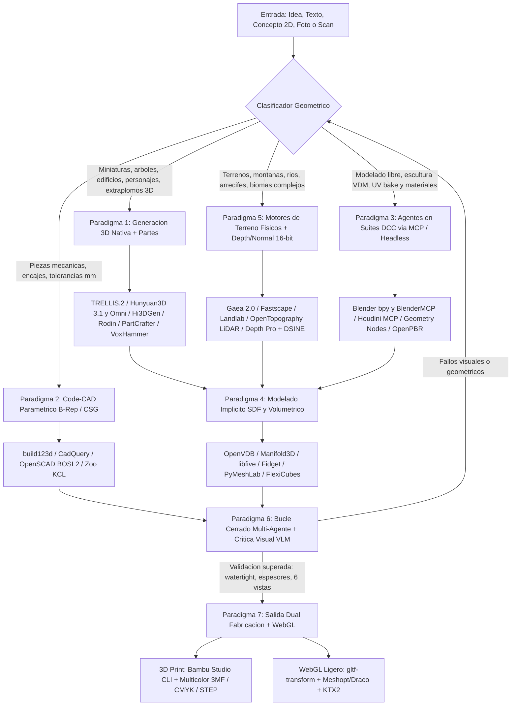
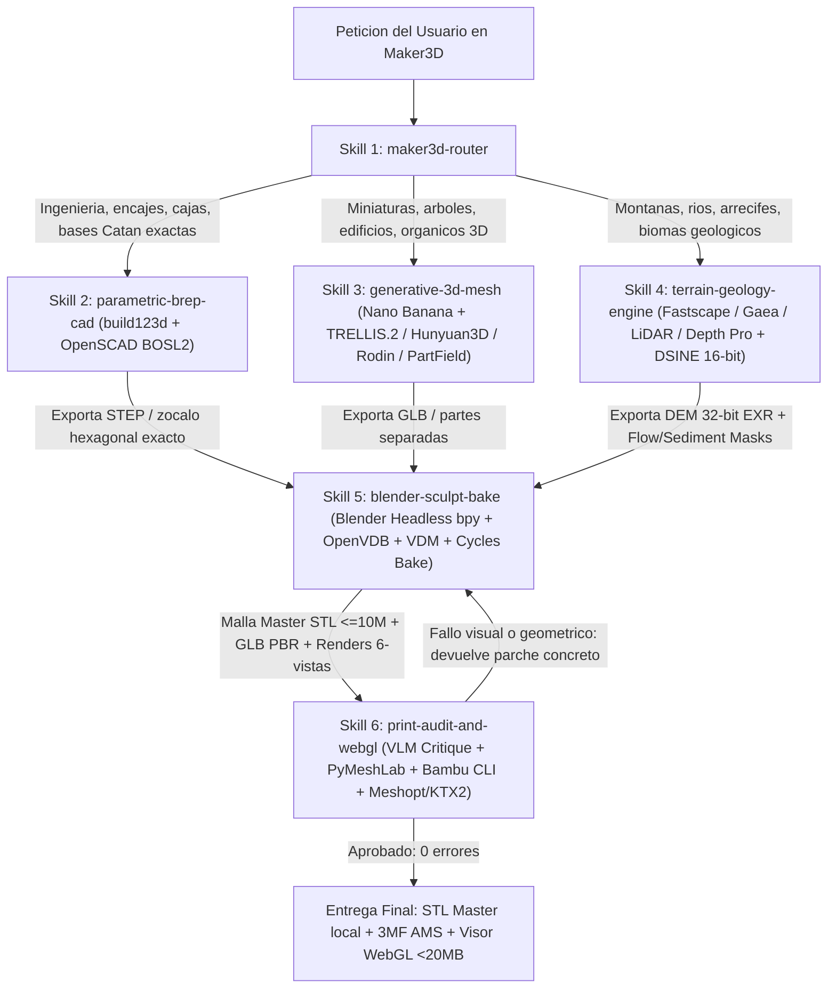

# Informe Maestro del Estado del Arte en Diseño 3D con IA (2025–2026) y Hoja de Ruta Arquitectónica Maker3D 2.0

**Fecha de elaboración:** 21 de noviembre de 2026  
**Proyecto:** Maker3D (`C:\Users\migue\Antigravity\Maker3D`)  
**Alcance:** Auditoría forense del historial real del proyecto (`registro.txt`), análisis exhaustivo de los 7 paradigmas actuales de diseño e ingeniería 3D asistida por IA, evaluación hardware/económica local vs. nube, y propuesta arquitectónica modular (**Maker3D 2.0**) con más de 190 fuentes primarias verificadas.

---

## Resumen Ejecutivo

Durante noviembre de 2026, Maker3D logró hitos técnicos notables con un pipeline sorprendentemente austero: usando prácticamente **una sola skill** ([nanobanana-3d-sculpt](file:///c:/Users/migue/Antigravity/Maker3D/.agents/skills/nanobanana-3d-sculpt/SKILL.md)), llamadas al subagente `image-generator` (Nano Banana) y código procedimental puro en `numpy` + `scipy` + `PIL` + `manifold3d`, se completaron los 8 biomas de Catán (`Montaña`, `Bosque`, `Colinas`, `Pastos`, `Campos`, `Desierto`, `Río de Oro` y `Océano`), variantes de alta complejidad (`Montaña DEF`, `Montaña Centrada V3`), una funda paramétrica imprimible (`Funda-Lapiz-Xiaomi V8.2`) y visores WebGL interactivos autónomos para móvil y escritorio.

Sin embargo, el análisis forense de las **665 líneas de `registro.txt`** y la comparación frente al estado del arte mundial de 2025–2026 revelan una conclusión inequívoca: **hemos exprimido casi al límite físico y matemático el paradigma "2D Image-to-Heightfield + NumPy puro", mientras que el ecosistema profesional ha evolucionado hacia pipelines especializados multi-herramienta.**

Cinco hallazgos estratégicos resumen esta brecha y su solución:

1. **Nano Banana es un motor artístico 2D, no un reconstructor geométrico 3D:** Pedir a un generador de imágenes 2D *heightmaps* ortográficos cenitales o múltiples vistas consistentes sin cámara calibrada produce inconsistencias físicas entre cara frontal y trasera, muros de agua por brillo de espuma, acantilados verticales de `85°` y baja densidad efectiva (`3–6 px/mm` en laderas oblicuas). Incluso en el célebre caso de referencia de Google DeepMind (*pagoda en CAD con Nano Banana*), el secreto nunca fue proyectar una imagen 2D a una malla NumPy, sino usar el concepto visual como entrada de **bucle cerrado VLM + MCP controlando suites 3D reales (Blender + OpenSCAD)** durante decenas de iteraciones.
2. **Una sola skill no sirve para tres naturalezas geométricas distintas:** En Maker3D coexisten al menos tres dominios incompatibles bajo un mismo flujo:
   - *Terrenos y dioramas geológicos* (`Tableros-Catan`), donde mandan los **HeightFields con erosión física**, **OpenVDB/SDF** y texturas **16-bit/32-bit**.
   - *Piezas mecánicas con tolerancias exactas* (`Funda-Lapiz-Xiaomi`, soportes, cajas, imanes hexagonales, encajes `0.15 mm`), donde manda el **Code-CAD B-Rep** (`build123d` sobre OpenCASCADE + `OpenSCAD/BOSL2`), que exporta archivos `STEP` nativos y falla con trazas claras cuando una booleana es inválida.
   - *Miniaturas, poblados, árboles y objetos orgánicos con extraplomos*, donde el relieve `2.5D` se "derrite" y mandan la **generación 3D nativa** (`TRELLIS.2`, `Hunyuan3D 3.1 / Omni`, `Hi3DGen`, `PartField`, `VoxHammer`) y la escultura/remallado en **Blender headless (`bpy`)**.
3. **Los visores HTML han tocado el techo de `50 MB` usando compresión Gzip cruda:** Con `2.3M–3.1M` triángulos y mapas WebP 4K alcanzamos `43.37–49.69 MB` por visor. El estándar WebGL 2026 (`gltf-transform` con **Meshopt/Draco** para geometría y **KTX2 Basis Universal** para texturas comprimidas directamente en VRAM) reduce esos mismos activos de `150–350 MB` sin comprimir a **`8–22 MB`**, cargando en `1–3 segundos` incluso en móviles sin saturar la memoria gráfica.
4. **Tu hardware actual dicta una arquitectura híbrida clara:** Tu equipo (`AMD Ryzen AI 7 350`, GPU integrada `Radeon 860M`, `32 GB RAM`, Windows, sin CUDA discreta) no es apto para ejecutar localmente modelos pesados de difusión 3D PyTorch/CUDA como `Hunyuan3D` o `TRELLIS.2` sin pelear con compilaciones frágiles ROCm/DirectML en Windows; en cambio, **sobra potencia en CPU+RAM** para ejecutar en local **Blender headless (`bpy`)**, **`build123d`**, **`OpenSCAD`**, **`PyMeshLab`**, **`Manifold3D`**, **`Fastscape/Landlab`**, **`Bambu Studio CLI`** (ya instalado) y **`gltf-transform`**, delegando únicamente la inferencia neuronal 3D pesada bajo demanda a APIs *pay-per-use* (`fal.ai`, Replicate, Hugging Face ZeroGPU o Modal) por unos pocos céntimos por pieza (`\$0.06–\$0.38`).
5. **El futuro en Maker3D pasa por una suite modular de 6 skills especializadas (`Maker3D 2.0`)**: Reemplazar la arquitectura monolítica centrada en Nano Banana por un enrutador inteligente que combine generación conceptual, reconstrucción 3D nativa o geológica, escultura/baking headless en Blender, ingeniería B-Rep en `build123d`, crítica visual automatizada VLM (*Write → Build → Render → Assert → Critique → Revise*) y pre-vuelo de impresión + exportación multicolor `3MF`/WebGL optimizado.

---

## Capítulo 1 — Auditoría Forense Completa de `Maker3D/registro.txt` (08/11/2026 – 19/11/2026)

Una arquitectura nueva solo sirve si resuelve los dolores reales documentados del proyecto. Al auditar cronológicamente las 665 líneas de [registro.txt](file:///c:/Users/migue/Antigravity/Maker3D/registro.txt) y el estado de [ESTADO.md](file:///c:/Users/migue/Antigravity/Maker3D/docs/ia/ESTADO.md), emergen con total claridad los límites que nos frenaron una y otra vez durante el diseño de las losetas de Catán, la funda de lápiz Xiaomi y el casco clon.

### 1.1 Línea temporal de incidentes y fricciones reales

| Fecha / Hito | Proyecto / Bioma | Síntoma documentado y citas literales del usuario | Causa raíz técnica descubierta | Coste en iteraciones y parche aplicado |
| :--- | :--- | :--- | :--- | :--- |
| **08/11/2026** | Consolidación `Maker3D` (`Casco-Clon`, `Funda-Xiaomi`, `Poliedros`, `Catan`) | Necesidad de unificar proyectos con decenas de scripts sueltos (p. ej. `test_v2`..`v33` en `Casco-Clon-Fase-2`). | Ausencia de separación entre generación orgánica, CAD paramétrico B-Rep y verificación de impresión. | Reorganización de carpetas y exclusión de binarios en `.gitignore`. |
| **13/11/2026 16:14–17:27** | `Loseta Montaña V2 → V3` | *"aun parece la textura de un juego de los 2000s... los colores no se funden bien entre si, es algo más bien basto, crudo. Tiene que parecer literalmente pintado... la forma asi abultada no me convence... Es antes una cordillera"* (`17:27`); visor bloqueado 10 min (`17:16`). | `SyntaxError` JS en plantilla WebGL (`})();`), texto/paleta discretizada por bandas crudas, ausencia de fusión continua PBR y silueta tipo domo. | Nuevo prototipo V3 procedimental (`prototype_v3_cordillera.py`, `5.18M Δ` STL, `roughness_4k`, visor `4.56 MB`). |
| **13/11/2026 18:09–18:50** | Creación `nanobanana-3d-sculpt` + `Montaña V4` | *"vi que unos importantes igenieros de google trabajaban en deepmind con Nanobanana para construir pagodas en CAD y el efecto final era brutal"* (`18:13`); *"esta pensada para ser vista solamente desde la perspectiva que nos lanza Nano banana"* (`18:20`). | El flujo inicial solo generaba 1 vista o 2 vistas (Sur+Norte); un único heightmap 2D de IA no garantiza lectura 360° ni pendientes sanas. | Primera versión de `.agents/skills/nanobanana-3d-sculpt/SKILL.md` (`V4`, `213,854 Δ`, ajuste `slope_gamma=0.72`). |
| **13/11/2026 18:52 – 14/11/2026 10:40** | `Biomas 1–8` (`Montaña`, `Bosque`, `Colina`, `Pasto`, `Campo`, `Desierto`, `Oro`, `Océano`) | Bloqueos repetidos de cuota `429 RESOURCE_EXHAUSTED` en `gemini-3.1-flash-image` (`~23:17 CET`, `04:17 CET` de ~4h46m, `10:40 CET`); más banda negra perimetral al unir terreno y zócalo. | Dependencia total de un único modelo propietario (`image-generator`) para 3 llamadas por bioma (sheet 6 vistas + heightmap + albedo), sin fallback local ni nube alternativa. | Timers de espera nocturnos (`4h15m`), parche de collar pizarra restringido por altura Z (`nx=420`, `291k Δ`). |
| **14/11/2026 01:24** | `Bioma 2 (Bosque)` y `Bioma 3 (Colinas)` | *"El bsque se ve fatal, parece que los arboles se derriten... El bioma de arcilla se ve bien pero muchos triangulos quedan mal por falta de calidad."* | El heightmap `2.5D` **no puede representar copas de árboles con extraplomos ni troncos bajo ramas**; además la cuantización 8-bit (`0..255`) creaba escalones y las diagonales del grid XY cruzaban las curvas de nivel. | Reemplazo total de Bosque por `manifold3d` (`build_bosque_3d.py`, 15 pinos 3D, `416k Δ`, `genus=41`); subida de Colinas a `nx=740` (`903,902 Δ`, `1,145,189` flips de arista). |
| **13/11/2026 22:44 & 14/11/2026 13:06** | `Funda-Lapiz-Xiaomi V8.1–V8.2` | Sistema *Slide-to-Release* inutilizado en la punta, suelo TPU macizo, alojamientos circulares de imanes sin escape de aire/pegamento y `click_groove` perforando el techo/imanes. | Modelado directo de booleanas por malla sin núcleo paramétrico B-Rep con restricciones explícitas de espesor mínimo de pared ni validación de colisiones inter-piezas automática en código CAD. | Reescritura manual en `generar_estuche.py` con cavidades hexagonales (`6.20 mm` entre caras, `r_out=3.58 mm`) y chequeo de intersecciones `0.0 mm³`. |
| **14/11/2026 12:32–18:30** | `Bioma 7 (Río de Oro v01–v05)` | **5 crisis encadenadas:** (1) baja resolución de color (`12:32`); (2) *"parece un poco 2D o caricaturesco"* (`13:02`); (3) *"se ven los triangulos"* (`13:11`); (4) *"Has quitado todo el 3d"* (`13:31`–`13:47`); (5) *"A pesar de haber ya 2,3 millones, se ven a simple vista los triangulos"* (`14:01`); (6) *"los picos no acaban de estar bien pulidos"* (`14:59`); (7) *"no sacado de un juego de los 2000s"* (`18:01`); (8) *"simplemente son muros de agua y punto"* (`18:30`). | (a) Faltaban atributos `tangent` por vértice en Three.js `r128`, por lo que `dFdx/dFdy(vUv)` sombreaba cada triángulo en rombos; (b) la malla mezclaba gradientes macro en el `normalMap`; (c) flips de arista sin guarda de aspecto `q` formaban agujas XY de `2.20 mm`; (d) la IA pintó espuma blanca brillante y el DEM extruyó ese brillo a muros de `+7 mm` (`hm=145..153`) con cauce sur cuesta arriba. | Cuadrantes macro 4K (`±0.07 px`), `order=3` bicúbico + subdivisión Red-Green + Taubin, guarda `q >= 0.29`, `--tangent-norm`, y reconstrucción hidráulica manual (`oro_heightmap_v5_hydro.png`), llevando el visor a `49.69 MB` (`v04`) / `48.68 MB` (`v05`). |
| **16/11/2026 00:46–01:29** | `Bioma 7 (Río de Oro v06–v08)` | *"otra vez no toda la textura tiene formas tio... Cometes continuamente el mismo error"* (`00:46`); *"puedes subir los triangulos hasta 10 millones"* (`00:55`); *"paredes y demas que tienen la textira de roca aun se ven en 2d"* (`01:29`). | (a) Basaltos oscuros (`lum=0.06..0.24`) recibían `3×–4×` menos relieve que areniscas claras; (b) `--water-mask` anulaba relieve de >25 piedras sumergidas; (c) desplazamiento puro en `+Z` desliza vértices en paralelo sobre paredes de `65°–88°` y estira 1–3 px UV arrastrando espuma turquesa. | Normalización local `lum_eq`, escultura zero-mean bajo agua, STL dual (`6.98M–8.00M Δ` local) y `sculpt_cliff_walls_3d` lateral por normal `(nx,ny,nz)` + shader triplanar `rock` en `assemble_viewer_v2.py`. |
| **16/11/2026 23:28 – 18/11/2026 23:38** | `Montaña V4`, `Montaña DEF` y `Montaña Centrada V1–V3` | Error `HTTP 400 INVALID_MEDIA`; *"NO reutilices tal cual el heightmap roto"* (`DEF`); *"Estamos de acuerdo en que estas vistas no acaban de tener sentido con una forma fisica real?"* (`11:09`); *"Y nano banana es un modelo preparado para cosas tan matematicas? no es mas artístico?"* (`11:11`); *"comparado con la referencia... Hace falta unas 10 veces mas resolucion"* (`17:48`). | Las imágenes 2D conceptuales (`1368×1536` por panel) solo cubrían ~`950×650 px` reales (`3–6 px/mm` en paredes oblicuas) y ocultaban el ~`70%` trasero/lateral. Rellenar lo ocluido con teselas Voronoi repetidas creaba líneas sin soporte 3D real ni coherencia espacial entre frente y dorso. | En V3 hubo que abandonar *Image-First* y re-arquitectar un escultor **Geometry-First 4K** 100% en NumPy (`montana_centrada_v3_sculpt.py`: 330 objetos discretos, `7.77M Δ` STL, visor `43.37 MB`). |

### 1.2 Los 9 modos de fallo estructurales (P1–P9) de nuestro enfoque actual

Al cruzar la tabla anterior con el código de [nanobanana-3d-sculpt/SKILL.md](file:///c:/Users/migue/Antigravity/Maker3D/.agents/skills/nanobanana-3d-sculpt/SKILL.md) y `Tableros-Catan/pipeline-biomas/`, aparecen **9 problemas raíz sistémicos**:

1. **P1 — Paradoja geométrica 2D→2.5D (Imposibilidad de extraplomos y oclusiones):** Representar la geometría mediante un único campo escalar $Z(x,y)$ prohíbe matemáticamente cuevas, copas de árboles bajo las cuales pasen troncos (`Bosque`), rocas salientes reales (`Río de Oro v08`), figuritas o escultura lateral verdadera. En paredes de $75^\circ\text{–}88^\circ$, cada milímetro horizontal abarca decenas de milímetros verticales, colapsando la densidad de muestreo y la proyección UV cenital.
2. **P2 — Alucinación física de Nano Banana como generador de mapas matemáticos (8-bit vs 16-bit + muros de agua):** Los modelos de difusión/imagen 2D confunden **luminancia fotográfica** (espuma blanca de cascadas, nieve brillante, reflejos especulares o sombras ambientales) con **elevación física**. De ahí nacieron los "muros de agua" de `+7 mm` en `Río de Oro v05`, el cauce que subía cuesta arriba y las mesetas truncadas de `85°` en `Montaña DEF`. Además, un JPG/PNG estándar de 8 bits solo ofrece `256` escalones de altura, provocando terrazas artificiales.
3. **P3 — Incoherencia multi-vista en 2D puro ("Efecto Janus" e invarianza de perspectiva):** Como detectó el usuario el `18/11/2026 11:09–11:15`, pedir a Nano Banana vistas frontales y traseras sin un estado 3D subyacente compartido produce geometrías físicamente imposibles ("tanto desde delante como desde atrás la roca está al final") y obliga a reconstruir ~`70%` de ángulos ciegos por heurística.
4. **P4 — Paridad 2D↔3D inversa e incompleta:** Al intentar que un albedo generado por IA "se convierta en 3D" mediante filtros morfológicos (`sculpt_albedo_microrelief`), las zonas oscuras (`lum = 0.06–0.24`) pierden `3×–4×` relieve, el agua se aplana borrando rocas sumergidas y los filtros suavizantes eliminan micro-detalles que luego siguen pintados en el diffuse, creando la sensación de *"textura pegada de juego de los 2000s"*.
5. **P5 — Patologías de triangulación en rejillas cartesianas deformadas:** Aunque `terrain_mesh_utils.py` introdujo warping, flips alineados a contorno, subdivisión Red-Green y Taubin smoothing, las rejillas 2D estiradas sobre relieves escarpados siguen exigiendo `7M–9.6M` triángulos para evitar facetas visibles o agujas (`p99 = 2.20 mm` antes de la guarda `q >= 0.29`), en lugar de trabajar con mallas adaptativas reales por curvatura/vóxeles (`OpenVDB`, `QuadriFlow`, `Blender Multiresolution`).
6. **P6 — Resolución efectiva insuficiente de texturas proyectadas desde concepto:** Una hoja de turnaround `1368×1536` equivale apenas a `3–6 px/mm` en laderas oblicuas de un hexágono de `128 mm`, mientras el visor objetivo 4K requiere `32 px/mm`. Parchear con cuadrantes 2D sin un motor de materiales PBR 3D nativo cuesta decenas de llamadas y arriesga costuras o sombras cocidas (*baked shadows*).
7. **P7 — Ausencia de un kernel B-Rep CAD para piezas mecánicas:** En `Funda-Lapiz-Xiaomi`, `Figuras-Poliedros` o en las propias tolerancias exactas de Catán (carril `3.50 mm`, pads `Ø20.00 mm`, bolsillo magnético `Ø10.20×5.20 mm`, futuras uniones machihembradas o bisagras), escribir primitivas y booleanas a mano en `numpy` o mallas carece de *filetes reales sobre aristas B-Rep*, exportación `STEP` industrial y detección automática de paredes finas o colisiones.
8. **P8 — Dependencia de cuello único en cuota (`429 RESOURCE_EXHAUSTED`):** Al basar toda la imaginación y los pases de textura/heightmap en `image-generator` (`gemini-3.1-flash-image`), cada límite de cuota congelaba el pipeline entero entre `4 y 5 horas`, sin motores 3D locales (Blender/Gaea/Fastscape/build123d) ni proveedores 3D alternativos.
9. **P9 — Saturación del presupuesto de `50 MB` en los visores WebGL:** Empaquetar buffers binarios de `2.3M–3.1M` triángulos comprimidos solo con Gzip + imágenes WebP 4K deja visores en `43.37–49.69 MB`, a pocos kilobytes del límite estricto de GitHub/repositorio (`50 MB`) y penalizando la decodificación en RAM/VRAM móvil.

### 1.3 La lección del caso Google DeepMind (Pagoda en CAD con Nano Banana)

El `13/11/2026 18:13`, el usuario citó como inspiración la demostración de ingenieros de Google DeepMind que lograban resultados espectaculares construyendo pagodas en CAD a partir de Nano Banana. Al contrastar cómo funcionan realmente esas arquitecturas (Gemini / Google Antigravity + Nano Banana + Blender MCP / OpenSCAD), se entiende por qué nuestro intento anterior quedó cojo:

| Aspecto | Qué hacía el demo DeepMind / Antigravity | Qué hicimos hasta ahora en `Maker3D` |
| :--- | :--- | :--- |
| **Papel de Nano Banana** | **Paso 1 exclusivamente:** generar el concepto artístico o láminas de referencia visual iniciales. | **Paso 1, 2 y 3:** también le pedimos heightmaps matemáticos cenitales y texturas UV bloqueadas al píxel. |
| **Motor de Geometría 3D** | **Blender (vía MCP / `bpy`)** para arquitectura, tejados curvos, ornamentos y materiales + **OpenSCAD/Code-CAD** para módulos paramétricos repetitivos. | **Scripts monolíticos NumPy/SciPy** calculando mallas triangulares a mano desde cero y proyectando `Z(x,y)`. |
| **Ciclo de Refinamiento** | Bucle autónomo multi-turno **Write → Execute → Render Multi-Angle → Visual VLM Critique → Edit** (decenas de ciclos evaluando silueta, iluminación, proporciones y colisiones). | Bucle largo reparando bugs numéricos (`dFdx`, saltos 8-bit, picos aguja, muros de agua) dentro de una geometría `2.5D` rígida. |
| **Resultado estructural** | Geometría 3D verdadera con extraplomos reales, piezas modulares limpias, iluminación PBR nativa y materiales separados. | Mallas `2.5D` densísimas (`4M–9.6M Δ`) intentando simular en `Z(x,y)` detalles propios de escultura 3D completa. |

---

## Capítulo 2 — Taxonomía de los 7 Paradigmas Mundiales del Diseño 3D con IA (2025–2026)

El ecosistema global de diseño 3D asistido por IA en 2026 no gira alrededor de una única herramienta mágica, sino de **7 paradigmas complementarios** que se orquestan según el tipo de objeto (mecánico, orgánico, diorama geológico, escena completa o producto multicolor imprimible).



| # | Paradigma | Herramientas y modelos representativos (2025–2026) | Fortaleza principal | Limitación crítica si se usa solo | Encaje en Maker3D |
| :-: | :--- | :--- | :--- | :--- | :--- |
| **1** | **Generación 3D Nativa (Difusión / Flow-Matching / O-Voxel / Partes)** | `TRELLIS.2`, `Hunyuan3D 3.1 / Omni`, `Hi3DGen`, `Direct3D-S2`, `TripoSF`, `Rodin 2.5`, `Meshy 7`, `PartCrafter`, `VoxHammer` | Verdadero 3D con extraplomos, reverso coherente, partes descompuestas y PBR multi-vista en `< 60 s`. | Escala sin milímetros exactos; suele requerir limpieza/escalado y cierre manifold para impresión FDM. | **Altísimo** para árboles de Bosque, poblados, monumentos, props de terreno y miniaturas. |
| **2** | **Code-CAD Paramétrico B-Rep / CSG** | `build123d`, `CadQuery`, `OpenSCAD + BOSL2`, `Zoo.dev (KCL / Zookeeper)`, `AdamCAD`, `FreeCAD`, `CAD-Coder`, `CADCodeVerify` | Precisión sub-milimétrica (`±0.01 mm`), tolerancias paramétricas, filetes exactos, exportación `STEP`, fallos explícitos. | Incapaz de modelar texturas orgánicas complejas o geología erosionada de forma natural. | **Crítico** para bases hexagonales Catan, imanes, encajes, `Funda-Lapiz-Xiaomi` y utillaje. |
| **3** | **Suites DCC controladas por Agentes (MCP / Headless Python)** | `Blender bpy` + `mcp-for-blender`, `Geometry Nodes`, `Cycles Bake`, `Houdini MCP`, `Rhino/Grasshopper MCP` | Combina escultura (VDM), booleanas OpenVDB, modificadores adaptativos y horneado (*baking*) real de PBR/desplazamiento. | Alto coste de tokens si se micro-gestiona vía chat paso a paso; API `bpy` sensible entre versiones. | **Columna vertebral** local en CPU para unir, esculpir, remapear UV y hornear PBR/normal/AO. |
| **4** | **Modelado Implícito SDF y Procesado Volumétrico** | `OpenVDB`, `Manifold3D`, `libfive`, `Fidget`, `fogleman/sdf`, `PyMeshLab`, `libigl`, `fTetWild`, `QuadriFlow` | Uniones orgánicas suaves (*smooth union*), cero errores no-manifold, reparación robusta de mallas rotas y remallado uniforme. | Requiere extracción isosuperficial y memoria RAM proporcional a la resolución del vóxel. | **Motor de reparación y fusión** garantizando `watertight=True`, `chi=2` y cortes exactos al hexágono. |
| **5** | **Motores de Terreno Físicos + LiDAR + Depth/Normal 16-bit** | `Gaea 2.0`, `World Machine`, `Houdini HeightFields`, `Fastscape`, `Landlab`, `OpenTopography`, `Depth Pro`, `Depth Anything V3`, `DSINE`, `Marigold` | Ríos, cascadas, terrazas y erosión hidráulica físicamente reales (cero muros de agua); mapas de `16/32 bits` sin cuantización. | Produce solo mapas/terrenos base `2.5D` que aún requieren máscara de hexágono y objetos 3D complementarios. | **Reemplazo directo** de los heightmaps 8-bit alucinados por Nano Banana para losetas de relieve. |
| **6** | **Bucles Multi-Agente con Crítica Visual VLM** | `BlenderGym`, `3DCodeBench`, `CADGenBench`, `MeshCoder`, `Scenethesis`, `VIGA`, `Holodeck 2.0` | Detecta partes flotantes, intersecciones, fallos de silueta y discrepancias 2D↔3D antes de dar la pieza por buena. | Mayor tiempo de cómputo e iteración (razonamiento multi-turno). | **Control de calidad obligatorio** integrado con Chromium/Blender renders ortográficos + arcilla. |
| **7** | **Fabricación Multicolor + Compresión WebGL Avanzada** | `Bambu Studio CLI`, `OrcaSlicer`, `lib3mf`, `ditherforge`, `PhysX-3D`, `Atlas3D`, `gltf-transform` (`Meshopt` + `Draco` + `KTX2`) | Impresión multicolor/CMYK automatizable sin pintar a mano; visores WebGL `3–5M Δ + 4K` comprimidos a `8–22 MB`. | Cuantizar de millones de tonos PBR a 4–16 carretes AMS introduce compromisos estéticos/purga. | **Última milla indispensable** para imprimir los 8 biomas y aligerar `Visores-HTML/` por debajo de `20 MB`. |

---

## Capítulo 3 — Generación 3D Nativa (2025–2026): Modelos, Partes, Edición Local, Topología y PBR

La revolución más grande respecto al flujo actual de Maker3D es que **ya no hace falta que un modelo 2D (Nano Banana) finja ser un motor 3D**. Desde finales de 2024 hasta finales de 2026 ha madurado toda una generación de modelos fundacionales *Image-to-3D*, *Multi-View-to-3D* y *Text-to-3D* que producen geometría volumétrica nativa, topología limpia, descomposición por partes y mapas PBR completos.

### 3.1 Modelos Fundacionales 3D Nativos (Open-Weights y Comerciales)

1. **Microsoft TRELLIS y TRELLIS.2 (`arXiv:2512.14692`, `microsoft/TRELLIS`, `microsoft/TRELLIS.2`):**
   - Representa el salto técnico más relevante en generación abierta de propósito general. **TRELLIS.2** escala a **4.000 millones de parámetros** sobre latentes estructurados (**SLAT**) e introduce **O-Voxel** (*omni-voxel*), una estructura dispersa libre de campos continuos implícitos que maneja nativamente topologías arbitrarias (superficies abiertas, geometría fina, cavidades internas) y materiales PBR completos (albedo, rugosidad, metalicidad e incluso opacidad/transparencia) hasta resoluciones de $1536^3$.
   - Disponible vía pesos abiertos o serverless en `fal.ai` (`fal-ai/trellis-2`, `\$0.059–\$0.30` por activo) y Replicate (`firtoz/trellis`).

2. **Familia Tencent Hunyuan3D (`2.0 → 2.1 → 2.5 → 3.0 / 3.1 → 3.5 → Buffalo 1.0 → Omni`):**
   - **Hunyuan3D 2.0 / 2.1** (`arXiv:2501.12202`, `arXiv:2506.15442`, `Tencent-Hunyuan/Hunyuan3D-2`, `Tencent-Hunyuan/Hunyuan3D-2.1`): arquitectura en dos etapas que separa la generación geométrica (`Hunyuan3D-DiT`) de la síntesis de materiales PBR (`Hunyuan3D-Paint` con albedo, metallic y roughness).
   - **Hunyuan3D 2.5** (`arXiv:2506.16504`): introduce el modelo base geométrico **LATTICE** (hasta `10B` de parámetros), cerrando drásticamente la brecha con el esculpido manual.
   - **Hunyuan3D 3.0 / 3.1 / 3.5 y Buffalo 1.0** (`arXiv:2608.02711`, `Tencent-Hunyuan/Hunyuan3D-Buffalo1.0`): aceleran la inferencia por debajo del minuto, permiten controlar rangos de polígonos (de `40K` hasta `1.5M–2M` caras en APIs `3.1 Pro` y texturas hasta `8K` PBR) e integran comprensión y edición multimodal en un mismo marco.
   - **Hunyuan3D-Omni** (`arXiv:2509.21245`, `Tencent-Hunyuan/Hunyuan3D-Omni`): **clave absoluta para Maker3D**. Permite condicionar la generación 3D no solo con una imagen, sino simultáneamente con **nubes de puntos, vóxeles, cajas delimitadoras (*bounding boxes*) y esqueletos**. En la práctica, esto significa poder suministrar el prisma hexagonal o la envolvente de una loseta/casco como restricción espacial directa al generador 3D.

3. **Step1X-3D (`stepfun-ai.github.io/Step1X-3D` / `Step1X-3D/Step1X-3D`):**
   - Entrenado sobre más de `5 millones` de activos curados, combina un generador de geometría híbrido **VAE-DiT** que produce representaciones **TSDF estancas (*watertight*) con muestreo de aristas vivas** y un módulo de textura basado en SD-XL con consistencia multi-vista. Su gran valor diferencial para personalización de estilo es que **permite transferir técnicas de control 2D (como LoRA) directamente a la síntesis 3D**.

4. **Hi3DGen (`arXiv:2503.22236`, `Stable-X/Stable3DGen`):**
   - Ataca exactamente el problema que sufrimos en Maker3D (la ambigüedad entre luz/color RGB y relieve geométrico) mediante **Normal Bridging**: primero traduce la imagen a un mapa de normales desacoplado de frecuencia (*NiRNE*) y luego genera la geometría latente desde las normales (*NoRLD*, entrenado en *DetailVerse*). Produce relieves y superficies esculpidas mucho más nítidas que los modelos que pasan directo de RGB a forma.

5. **Direct3D-S2 (`arXiv:2505.17412`, `DreamTechAI/Direct3D-S2`) y UltraShape 1.0 (`arXiv:2512.21185`, `PKU-YuanGroup/UltraShape-1.0`):**
   - **Direct3D-S2** utiliza *Spatial Sparse Attention (SSA)* sobre un Sparse SDF VAE uniforme (*SS-VAE*) para alcanzar generación volumétrica de $1024^3$ (~`3.9×` más rápido en inferencia).
   - **UltraShape 1.0** divide el proceso en localización espacial gruesa + refinamiento fino mediante vóxeles anclados posicionalmente (RoPE) y un estricto filtrado *watertight* de datos de entrenamiento.

6. **Ecosistema Tripo (Comercial `H3.1` + Open-Weights `TripoSG` / `TripoSF`) y SPAR3D:**
   - **TripoSG** (`arXiv:2502.06608`, `VAST-AI-Research/TripoSG`): modelo *rectified flow* entrenado con ~`2 millones` de pares Imagen-SDF usando supervisión híbrida de SDF, normales y pérdida eikonal; destaca interpretando bocetos, dibujos estilizados y fotos.
   - **TripoSF** (`arXiv:2503.21732`, `VAST-AI-Research/TripoSF`): usa **SparseFlex** (combinación de FlexiCubes + vóxeles dispersos a $1024^3$) preservando superficies abiertas e interiores complejos sin destruir detalles por cierres forzados prematuros.
   - **SPAR3D** (`arXiv:2501.04689`, Stability AI, `Stability-AI/stable-point-aware-3d`): reconstruye un mesh texturizado en `~0.7 s` mediante difusión rápida de nube de puntos + regresión, permitiendo editar interactivamente la nube de puntos ocluida.

7. **Plataformas Comerciales de Referencia y Refinadores de Micro-Detalle:**
   - **Hyper3D Rodin (Gen-2 / v2.5):** Referente en fidelidad artística y micro-superficies; acepta **hasta 5 vistas de referencia simultáneas**, algo perfecto cuando ya tenemos 4–6 vistas generadas por Nano Banana, aunque sus mallas a veces requieren limpieza topológica para impresión.
   - **Meshy (v7 / 7.1):** Lidera el flujo *todo-en-uno* orientado a impresión 3D al incorporar chequeo de imprimibilidad, auto-reparación manifold, retopología y exportación directa a `3MF` multicolor.
   - **ByteDance Seed3D 1.0 / 2.0** (`arXiv:2510.19944`, `arXiv:2605.13862`, `Seed3D/Seed3D`): pensado para activos *simulation-ready* con escala métrica real, PBR unificado y descomposición articulada.
   - **DetailGen3D** (`arXiv:2411.16820`, `VAST-AI-Research/DetailGen3D`) y **CraftsMan3D** (`arXiv:2405.14979`, `wyysf-98/CraftsMan`): pipelines especializados en tomar una malla 3D gruesa e **inyectar detalle geométrico de alta frecuencia** guiado por normales o flujo latente dependiente de datos.
   - **Precursores y bloques base todavía útiles en ComfyUI/pipelines ligeros:** **3DTopia-XL** (`arXiv:2409.12957`, `3DTopia/3DTopia-XL`, representación PrimX con PBR GLB), **Unique3D** (`arXiv:2405.20343`, `AiuniAI/Unique3D`, reconstrucción ISOMER), **InstantMesh** (`arXiv:2404.07191`, `TencentARC/InstantMesh`, LRM en ~`10 s`) y **MeshLRM**.

| Modelo / Plataforma | Tipo y Acceso | Resolución / Capacidad Máxima | Texturas / PBR | Idoneidad para Maker3D |
| :--- | :--- | :--- | :--- | :--- |
| **TRELLIS.2** | Open-weights (`4B`) + `fal.ai` / Replicate | O-Voxel hasta $1536^3$ | PBR completo (Albedo, Roughness, Metal, Opacidad) | Excelente para árboles, rocas compuestas, edificaciones y miniaturas. |
| **Hunyuan3D 3.1 Pro / 2.5 / Omni** | Open-weights (`2.1`/`Omni`) + API Tencent/`fal.ai`/Replicate | `40K–1.5M/2M` caras; control por caja/vóxel en `Omni` | `Hunyuan3D-Paint` hasta `4K/8K` PBR | Mejor candidato estructural para piezas compuestas encajadas en huella hexagonal. |
| **Hi3DGen (`Stable3DGen`)** | Open-weights / ComfyUI | Alta fidelidad de relieve vía *Normal Bridging* | Geometría sin textura (se texturiza después) | Muy prometedor para convertir imágenes de relieves/rocas en escultura nítida. |
| **Hyper3D Rodin v2.5** | Comercial / SaaS / API (`blender-mcp`) | Multi-imagen (hasta `5` vistas de concepto) | PBR alta fidelidad (`GLB/OBJ/FBX/USDZ`) | Óptimo cuando Nano Banana ya generó un turnaround consistente de 4–5 ángulos. |
| **Meshy 7.1** | Comercial / SaaS / `meshy-mcp-server` | Text/Image-to-3D + retopología + print check | PBR hasta `8K` + export `3MF` multicolor | Camino más rápido para props y miniaturas directos a Bambu Studio. |
| **Tripo H3.1 / TripoSF** | Comercial + Open-weights (`TripoSG`/`TripoSF`) | `8–30 s`; SparseFlex $1024^3$ | Smart Mesh + PBR + auto-rigging | Prototipado rápido de personajes, criaturas o edificios modulares. |

### 3.2 Generación y Segmentación 3D por Partes (La clave para AMS Multicolor y Edición)

Uno de los mayores saltos de 2025–2026 es abandonar la generación de "bloques monolíticos pegados" en favor de **modelos 3D conscientes de sus partes semánticas**:

- **PartCrafter** (`arXiv:2506.05573`, `wgsxm/PartCrafter`, NeurIPS): genera simultáneamente en un único paso DiT múltiples partes 3D separadas y completas a partir de una sola imagen, sin segmentación previa.
- **PartPacker** (`arXiv:2506.09980`, `NVlabs/PartPacker`): comprime y elimina ruido conjuntamente en volúmenes duales empaquetados para mantener la coherencia de ensamblaje entre piezas.
- **OmniPart** (`arXiv:2507.06165`, `https://omnipart.github.io/`, SIGGRAPH Asia): planifica primero la distribución por cajas 3D desde máscaras 2D y genera cada pieza desacoplada semánticamente mediante flujo rectificado.
- **HoloPart** (`arXiv:2504.07943`, `VAST-AI-Research/HoloPart`): realiza compleción *amodal* de partes ocluidas, reconstruyendo el dorso oculto de un componente parcialmente tapado por otro (p. ej., un tronco detrás de ramas o una pieza de armadura).
- **SAMesh** (`arXiv:2508.14036`, `gtangg12/samesh`) y **PartField** (`arXiv:2504.11451`, NVIDIA Toronto AI): segmentan cualquier malla 3D existente (generada o escaneada) en partes jerárquicas coherentes combinando renders multimodales (`SAM 2`) o campos continuos de características 3D.

**Por qué esto cambia las reglas del juego en Maker3D:** Si una loseta de Bosque, un poblado o un casco se genera o segmenta en **partes independientes** (base de roca, troncos, copas, tejado, muros, aletas), cada parte puede imprimirse en un carrete distinto del AMS, escalarse sin deformar las demás, repararse por separado con `Manifold3D` o texturizarse con materiales distintos sin sangrado de colores.

### 3.3 Edición Local 3D Nativa (Corregir un fallo sin regenerar toda la pieza)

En nuestro historial de `Río de Oro` y `Montaña`, cambiar una cascada o redondear una cresta obligaba a recompilar toda la pieza o sufrir regresiones globales (`14/11/2026 13:31`: *"simplemente has jodido lo que habias hecho"*). Los modelos recientes permiten edición localizada directa en 3D:

- **VoxHammer** (`arXiv:2508.19247`, `huanngzh/VoxHammer`, 3DV Oral): trabaja *training-free* directamente dentro del espacio latente 3D de arquitecturas tipo TRELLIS usando **KV-caching** sobre la zona no editada. Congela el `95%` intacto del modelo y regenera con coherencia únicamente la región marcada por una máscara 3D.
- **Nano3D / Nano3D-Edit** (`arXiv:2510.15019`, `jamesyjl/Nano3D`): edición 3D *training-free* sin requerir máscaras 3D estrictas.
- **Tailor3D** (`arXiv:2407.06191`, `alexzyqi/Tailor3D`) y **MVEdit** (`Lakonik/MVEdit`): permiten editar vistas proyectadas en 2D y consolidar el cambio de vuelta al modelo 3D de forma consistente.
- **Hunyuan3D-Edit / Buffalo** e **Inpaint3D (Masked LRMs)**: regeneran secciones enmascaradas dentro de una caja delimitadora 3D en una sola pasada hacia adelante.

### 3.4 Topología Artística Autoregresiva e Isosuperficies Diferenciables

Mientras `Marching Cubes` y las rejillas cartesianas deformadas generan millones de micro-triángulos isotrópicos con aristas en zigzag sobre filos duros, la investigación en topología sigue dos líneas:

1. **Transformers autoregresivos de topología humana (Artist-Created Meshes):**
   - **MeshAnything V2** (`arXiv:2408.02555`, `buaacyw/MeshAnythingV2`), **TreeMeshGPT** (`arXiv:2503.11181` / `arXiv:2503.11629`, `sail-sg/TreeMeshGPT` / `StefanLionar/TreeMeshGPT`), **EdgeRunner** (`arXiv:2409.18114`, `NVlabs/EdgeRunner`) y **Meshtron** (`arXiv:2412.09548`, `https://research.nvidia.com/labs/dir/meshtron/`, `GauravPatil8/Nvidia-Meshtron-Pytorch`) toman una nube de puntos o malla densa y predicen secuencialmente caras limpias siguiendo el flujo natural de aristas que esculpiría un artista, reduciendo polígonos en órdenes de magnitud para visores WebGL y videojuegos.
2. **Extracción isosuperficial diferenciable de aristas vivas:**
   - **DMTet** (`arXiv:2111.04276`, `nv-tlabs/DMTet`) y **FlexiCubes** (`arXiv:2308.05371`, `NVIDIAGameWorks/kaolin`) optimizan las posiciones de vértices sobre rejillas tetraédricas/cúbicas para capturar crestas afiladas y aristas de roca sin suavizarlas en bolas ni disparar el conteo de polígonos.

### 3.5 Texturizado PBR 3D Nativo y Librerías de Materiales SVBRDF

La sensación de *"juego de los 2000s"* y de *"textura pegada en 2D"* en `Montaña V2` y `Río de Oro` nació de proyectar una foto cenital 2D en espacio UV plano. El estándar actual texturiza **en el espacio 3D de la malla y descompone canales SVBRDF libres de sombras cocidas**:

- **Hunyuan3D-Paint** (integrado en `Tencent-Hunyuan/Hunyuan3D-2.1`, módulos *RomanTex* / *MaterialMVP*): sintetiza mapas completos de **Albedo + Metallic + Roughness** sincronizados entre múltiples vistas alrededor de la malla real ya construida.
- **MV-Adapter** (`arXiv:2412.03632`, `huanngzh/MV-Adapter`): convierte modelos 2D en generadores consistentes multi-vista condicionados por mapas de posición/normales de nuestra propia malla (`IG2MV` / `T2MV`), ideal en `ComfyUI-3D-Pack`.
- **Material Anything** (`arXiv:2411.15138`, `3DTopia/MaterialAnything`): añade materiales PBR realistas a cualquier malla (con o sin textura previa) eliminando sombras ambientales mediante máscaras de confianza y un refinador en espacio UV.
- **SyncMVD** (`arXiv:2311.12891`, `LIU-Yuxin/SyncMVD`) y **Paint3D** (`arXiv:2312.13913`, `OpenTexture/Paint3D`): sincronizan difusión en espacio UV latente para eliminar costuras entre vistas e *inpainting* de agujeros o zonas ocluidas (resolviendo exactamente el problema del `70%` ocluido que sufrimos en `Montaña Centrada V1/V2`).
- **Generadores de materiales tileables PBR y estándares abiertos:** **MatFuse** (`arXiv:2308.11408`, `gvecchio/MatFuse`) y **CHORD** (Ubisoft) generan materiales PBR sin costuras (Diffuse, Normal, Roughness, Displacement 16-bit) desde texto/foto; junto a librerías **CC0 escaneadas reales hasta 8K** como **Poly Haven** (`polyhaven/polyhaven.com`) y **ambientCG** (`https://ambientcg.com`), intercambiables bajo el estándar industrial **OpenPBR** (`AcademySoftwareFoundation/OpenPBR`) y **MaterialX** (`AcademySoftwareFoundation/MaterialX`).

### 3.6 Reconstrucción Multi-Vista, 3DGS → Watertight Mesh y World Models

Cuando sí se parte de fotografías reales o de un conjunto de vistas consistentes:

- **Regresión geométrica feed-forward sin calibración manual previa:** **DUSt3R** (`naver/dust3r`), **MASt3R** (`naver/mast3r`) y **VGGT** (`vgg-t/vggt`, `nv-dvl/vgg-ttt`) estiman automáticamente en una pasada las cámaras, profundidades y nubes de puntos densas 3D a partir de 1 a cientos de imágenes, eliminando la calibración manual por esquinas que tuvimos que programar a mano en `montana_sculpt_v4.py` y `montana_centrada_prep.py`.
- **Multi-vista + normales acopladas:** **Zero123++** (`arXiv:2310.15110`, `SUDO-AI-3D/zero123plus`), **Wonder3D** (`arXiv:2310.15008`, `xxlong0/Wonder3D`) y **Era3D** (`arXiv:2405.19523`, `pengHTYX/Era3D`) predicen vistas y mapas de normales acoplados desde una imagen.
- **De Gaussian Splatting a Malla Estanca Imprimible:** El 3DGS clásico es una nube de elipsoides imposibles de imprimir; pero su evolución geométrica —**SuGaR** (`arXiv:2311.12775`, `Anttwo/SuGaR`), **2DGS** (`arXiv:2402.10059`, `hbb1/2d-gaussian-splatting`), **GOF** (`arXiv:2404.10772`, `autonomousvision/gaussian-opacity-fields`), **PGSR** (`arXiv:2406.06527`, `zju3dv/PGSR`) y especialmente **MILo** (*Mesh-In-the-Loop Gaussian Splatting*, `arXiv:2506.24096`, `Anttwo/MILo`, SIGGRAPH Asia)— optimiza una malla extraíble de forma diferenciable en cada iteración, reduciendo vértices en un orden de magnitud sin ruido interno.
- **Modelos de Mundo 3D (para dioramas y tableros completos):** **HunyuanWorld-Mirror / HY-World 2.0** (`arXiv:2510.10726`, `arXiv:2604.14268`, `Tencent-Hunyuan/HunyuanWorld-Mirror`) y **World Labs Marble** (`https://marble.worldlabs.ai`) generan entornos 3D navegables exportables en *splats* y mallas.

---

## Capítulo 4 — Code-CAD Paramétrico con IA y Núcleos B-Rep (Ingeniería Exacta)

Mientras la generación neuronal resuelve lo orgánico y artístico, en **piezas funcionales con tolerancias milimétricas** (`Funda-Lapiz-Xiaomi`, carril `3.50 mm`, bases `Ø20.00 mm`, cavidades hexagonales `6.20 mm` o cajas con clips) las mallas generativas fallan por definición: carecen de paramétrica, no garantizan paralelismo ni espesores exactos y no exportan sólidos industriales `STEP`.

En 2025–2026 la comunidad de ingeniería ha estandarizado el **Code-CAD**, donde el agente LLM escribe código declarativo verificable en lugar de manipular triángulos a ciegas.

### 4.1 Comparativa de Lenguajes y Núcleos Code-CAD para Agentes IA

| Plataforma / Librería | Kernel Geométrico | Lenguaje / Paradigma | Exportación | Comportamiento en bucles IA (`CADGenBench` / `ModelRift`) | Veredicto Maker3D |
| :--- | :--- | :--- | :--- | :--- | :--- |
| **`build123d`** (`gumyr/build123d`) | **OpenCASCADE (`OCCT`)** B-Rep exacto | Python moderno con *context managers* (`BuildPart`, `BuildSketch`) | **`STEP`**, `STL`, `3MF`, `BREP` | **Líder en benchmarks 2026 (`CADGenBench`)**. *Fails loudly & early*: lanza excepciones exactas si un filete o booleana es inválido y permite consultar volumen, centro de masa, aristas y caras en mitad del script. | **Estándar principal recomendado** para toda pieza mecánica, carcasas, encajes y bases Catan. |
| **`CadQuery`** (`CadQuery/cadquery`) | **OpenCASCADE (`OCCT`)** B-Rep exacto | Python encadenado fluido (`.faces(">Z").workplane()...`) | **`STEP`**, `STL`, `3MF`, `AMF` | Misma potencia B-Rep que `build123d`, pero la sintaxis en cadenas largas provoca más errores de contexto en LLMs que la programación orientada a objetos con variables locales de `build123d`. | Alternativa madura con gran ecosistema (`cq-gridfinity`). |
| **`OpenSCAD + BOSL2`** (`openscad/openscad`, `BelfrySCAD/BOSL2`) | Manifold / CGAL (CSG por mallas) | DSL declarativo (`module`, `difference()`) | `STL`, `3MF`, `OFF` (sin `STEP` nativo) | **Mayor volumen de entrenamiento previo en LLMs** y compilación rapidísima. **Peligro crítico ("Fallo silencioso"):** si una booleana crea paredes de espesor cero o partes flotantes, compila sin error en código y engaña al agente. Además, los *fillets* reales tras booleanas son muy complejos. | Ideal como secundario rápido o puenteado al kernel B-Rep vía `scad123d`. |
| **`Zoo.dev` (`KCL` + `Zookeeper`)** | Motor B-Rep propietario API-first (**KittyCAD**) | **KCL** (KittyCAD Language) híbrido GUI + código | **`STEP`**, `GLTF`, `STL`, `OBJ` | Agente conversacional nativo (*Zookeeper*) integrado en *Zoo Design Studio* que edita código KCL paramétrico bidireccionalmente con la vista 3D. | Excelente referencia de flujo híbrido comercial/API. |
| **`AdamCAD`** (`https://adam.new`) | Motor paramétrico con sliders UI | Lenguaje natural → pieza con parámetros editables en web | `STL` / paramétrico web | Enfocado en prototipado mecánico inmediato (*"AI mechanical engineer"*). | Útil para prototipos rápidos externos, menor integración en pipeline local. |
| **`FreeCAD`** (vía Python / `freecad-mcp`) | **OpenCASCADE (`OCCT`)** | GUI + API Python + FEM | **`STEP`**, `FCStd`, `STL` | Permite inspeccionar árbol paramétrico completo y lanzar simulaciones FEM de esfuerzos desde el agente. | Complemento GUI visual excelente si se desea inspección manual o FEM. |

### 4.2 Lecciones clave de `CADGenBench`, `scad123d` y el ecosistema Code-CAD

1. **"Fails Loudly & Early" supera al fallo silencioso:** En nuestras pruebas de `Funda-Lapiz-Xiaomi V8.1→V8.2` (`registro.txt` líneas 129–142 y 286–301), tuvimos errores graves porque el sistema de mallas permitía que el `click_groove` perforase las cavidades de los imanes o que el inserto quedase sin holgura de liberación en la punta hasta una revisión manual posterior. Con **`build123d` + `PartCAD`** (`partcad/partcad`) + aserciones Python sobre el sólido OCCT (`assert (base & lid).volume == 0.0`, `assert solid.is_valid()`, chequeo de espesor mínimo por raycasting), el script **aborta en el acto** con la línea culpable exacta antes incluso de renderizar.
2. **Interoperabilidad `OpenSCAD ↔ build123d ↔ VS Code`:**
   - **`etjones/scad123d`**: permite importar bibliotecas probadas de `BOSL2` (engranajes, roscas, bisagras *print-in-place*, encajes *snap-fit*) dentro de `build123d` y exportar `STEP` sólido.
   - **`michaelgale/cq-gridfinity`**: patrón de referencia para sistemas modulares con imanes y tolerancias globales paramétricas (`clearance = 0.20`), directamente trasladable a un módulo **`catan-hex-kit`**.
   - **`bernhard-42/vscode-ocp-cad-viewer` (`ocp_vscode`)**: visor CAD interactivo en vivo dentro del IDE para inspeccionar sólidos B-Rep, aristas seleccionadas y cortes sin compilar HTMLs pesados durante el desarrollo.

### 4.3 Modelos Fundacionales CAD-AI Especializados (2024–2026)

La academia ya entrena modelos específicos para generar y verificar código paramétrico:
- **CAD-Coder** (`arXiv:2505.19713`, `gudo7208/CAD-Coder`, NeurIPS): traduce texto o imágenes a scripts ejecutables `CadQuery` usando SFT + aprendizaje por refuerzo **GRPO** con recompensa geométrica directa (Distancia de Chamfer) y *Chain-of-Thought*.
- **CAD-Recode** (`arXiv:2412.14042`, `filaPro/cad-recode`, ICCV) y **cadrille** (`arXiv:2505.22914`, `maksimko123/cadrille`): realizan **ingeniería inversa**, convirtiendo nubes de puntos, fotos o texto de un objeto existente (p. ej. un escaneo o una malla generada por Hunyuan3D) en código `CadQuery` limpio y editable por humanos.
- **CADCodeVerify** (`arXiv:2410.05340`, `Kamel773/CAD_Code_Generation`, ICLR): marco iterativo que toma capturas del sólido CAD generado y hace que un VLM formule preguntas de verificación dimensional/topológica (VQA) para corregir discrepancias automáticamente.
- **Text2CAD** (`arXiv:2409.17106`), **Query2CAD** (`arXiv:2406.00144`, `akshay140601/Query2CAD`) y **CadVLM** (`arXiv:2409.17457`, Autodesk): completan el mapa desde instrucciones en lenguaje natural hasta bocetos paramétricos con restricciones geométricas automáticas.

---

## Capítulo 5 — Ecosistema Real de MCP Servers, Agent Skills y Suites DCC

La forma dominante en que los equipos avanzados diseñan en 3D con agentes en 2025–2026 combina **estándares portables de instrucciones (`SKILL.md`)** descubiertos en índices curados (**`zhuyansen/awesome-3d-skills`**, **`mlightcad/awesome-cad-agent`**, **`skills.sh`**) con **servidores MCP (*Model Context Protocol*)** conectados directamente al motor 3D o a la nube de inferencia.

### 5.1 Catálogo Estructurado de Servidores MCP y Herramientas Agénticas Verificadas

| Categoría | Servidor / Proyecto | Repositorio / Endpoint Verificado | Capacidades principales expuestas al agente |
| :--- | :--- | :--- | :--- |
| **Blender / Escultura y Render** | `mcp-for-blender` (`blender-mcp`) | `ahujasid/mcp-for-blender`, `carlosh7/blender-mcp` | Ejecución `bpy` en vivo, inspección de escena, Poly Haven (HDRI/texturas/modelos), disparador de **Hyper3D Rodin / Hunyuan3D / Meshy / Tripo**, capturas de viewport. |
| **Blender Headless / CI** | `blender-3dprint-toolkit` / `blender-cli` | `emarelly/blender-3dprint-toolkit`, `renezander030/blender-cli` | Pipelines reproducibles sin GUI (`blender --background --python`), pruebas de espesor/voladizos/ajuste y control JSON sin dependencias. |
| **Code-CAD B-Rep** | `build123d-mcp` / `mcp-cadquery` / `PartCAD` | `pzfreo/build123d-mcp`, `bertvanbrakel/mcp-cadquery`, `partcad/partcad` | Sesiones Python persistentes, cálculo de masa/volumen, validación imprimible FDM, cortes seccionales y renders SVG/PNG paso a paso. |
| **OpenSCAD** | `OpenSCAD-MCP-Server` / `openscad-mcp` / `openscad-agent` | `jhacksman/OpenSCAD-MCP-Server`, `sergiudanstan/openscad-mcp`, `jabberjabberjabber/openscad-mcp`, `iancanderson/openscad-agent` | Chequeo de sintaxis, render multi-ángulo PNG para bucle visual VLM y compilación directa a `STL`/`3MF`. |
| **CAD GUI & Paramétrico** | `freecad-mcp` / `rhino-grasshopper-mcp` | `neka-nat/freecad-mcp`, `bonninr/freecad_mcp`, `dongwoosuk/rhino-grasshopper-mcp`, `alfredatnycu/grasshopper-mcp` | Creación/edición en FreeCAD + FEM, o cableado algorítmico de grafos en Rhino/Grasshopper. |
| **Procedural & Motores** | `Houdini MCP` / `Unreal-MCP` / `unity-mcp` | `healkeiser/fxhoudinimcp`, `JTCHE/houdini-mcp`, `IvanMurzak/Unreal-MCP`, `ChiR24/Unreal_mcp`, `CoplayDev/unity-mcp`, `AnkleBreaker-Studio/unity-mcp-server` | Grafos SOP/HeightField/VEX en Houdini + ensamblaje interactivo de escenas, iluminación y shaders en tiempo real. |
| **Generación 3D Cloud** | `Meshy MCP` / `Tripo MCP` / `fal.ai MCP` / `Replicate MCP` | `meshy-dev/meshy-mcp-server`, `Tripo-Developer/tripo-mcp`, `mordor-forge/trident-mcp`, `https://mcp.fal.ai/mcp`, `raveenb/fal-mcp-server`, `https://mcp.replicate.com/sse` | Disparo asíncrono de generación 3D nativa (`TRELLIS.2`, `Hunyuan3D 3.1`, `Meshy`, `Tripo`, `Rodin`), remallado y texturizado PBR desde el propio IDE. |
| **Grafos Modulares Local/Cloud** | `ComfyUI-3D-Pack` | `MrForExample/ComfyUI-3D-Pack` | Orquestación visual por nodos de `Hunyuan3D`, `TRELLIS`, `MV-Adapter`, `TripoSG`, `PartCrafter`, `Stable3DGen` y horneado `nvdiffrast`. |
| **Slicing & Impresión 3D** | `bambu-cli-mcp` / `bambu-printer-mcp` | `catesworks/bambu-cli-mcp`, `DMontgomery40/bambu-printer-mcp` | Laminado CLI con Bambu Studio / OrcaSlicer, empaquetado `3MF` y puente MQTT/FTPS a impresora Bambu Lab. |

### 5.2 El Flujo Técnico Maestro en Blender Headless (`bpy` + OpenVDB + VDM + Cycles Bake)

Para Maker3D, **Blender en modo headless (`blender --background --python script.py`)** es la pieza ausente más rentable del mundo profesional, y además **funciona al 100% sobre CPU/32 GB RAM en Windows** sin requerir GPU NVIDIA. Reemplaza miles de líneas frágiles de triangulación manual en `numpy` por cinco operaciones industriales probadas:

1. **Geometry Nodes con Campos de Pendiente, Altura y Flujo:** En lugar de escribir rejillas 2D fijas, Geometry Nodes subdivide adaptativamente, evalúa normales locales (`normal.z < 0.72` para aislar paredes escarpadas), aplica ruidos *Voronoi* y *Musgrave* direccionales sobre acantilados mediante el nodo `Set Position` a lo largo de la normal 3D (superando el techo de `2.5D`) y usa **Simulation Zones** para iterar erosión o partículas de agua.
2. **OpenVDB Voxel Remesh (`modifier.mode = 'VOXEL'`):** Convierte cualquier conjunto de objetos solapados —un zócalo hexagonal, un terreno erosionado, 15 árboles de Bosque, 150 cantos rodados y un poblado— en una **única piel topológica 100% estanca sin caras interiores ni auto-intersecciones**, ahorrándonos semanas de depuración de `manifold3d`/booleans rotos.
3. **VDM Brushes (*Vector Displacement Maps*) y Multiresolution:** A diferencia de los mapas de altura `1D` (`Z` puro), los pinceles **VDM desplazan en 3D `(dx, dy, dz)`**, esculpiendo voladizos reales, estratos rocosos salientes y cornisas de acantilado imposibles en `2.5D`. Con el modificador **Multiresolution**, podemos esculpir poros de roca y grietas finas a nivel 5–6 (`~8M Δ`) para el **STL Master local** y exportar el nivel 3–4 para WebGL sin perder la forma macro.
4. **Cycles Bake (*Selected to Active*):** Permite hornear toda la geometría ultra-densa (`8M Δ`) + shaders procedimentales OpenPBR (`Poly Haven` / `ambientCG` / `CHORD`) hacia mapas `4096×4096` perfectamente alineados (**Diffuse Albedo**, **Tangent Normal Map** libre de *double-tilting*, **Roughness** y **Ambient Occlusion**) sobre una malla WebGL limpia y ligera (`150K–400K Δ`).
5. **Auditoría automática via `bmesh` y `3D-Print Toolbox`:** Antes de guardar el `STL`/`3MF`, el propio script consulta `is_manifold`, vértices frontera abiertos, volumen, área de caras degeneradas y voladizos críticos.

### 5.3 Crítica Honesta de la Comunidad (Reddit / Hacker News) — Cómo NO Usar MCP

Los desarrolladores veteranos en `r/LocalLLaMA`, `r/ClaudeCode` y Hacker News documentan cuatro trampas reales del hype alrededor de `blender-mcp` y `OpenSCAD`:

- **El "Impuesto de Tokens" por micro-llamadas MCP:** Construir un modelo complejo haciendo 60 llamadas MCP de *"añade un cubo", "muévelo 2 mm", "toma captura", "añade otro cilindro"* dispara la latencia, satura el contexto y quema tokens. **La práctica óptima en ingeniería agéntica** es usar scripts **Python batch reproducibles** ejecutados con `blender --background --python build.py` que produzcan el modelo + renders multiperspectiva en una sola llamada, reservando `blender-mcp` solo para inspección interactiva o ajustes finos puntuales.
- **Fragilidad de versión en `bpy`:** La API de nodos y exportadores de Blender cambia entre versiones (`3.x` vs `4.x`). Todo skill debe fijar explícitamente la versión objetivo de Blender y probar sintaxis en CI antes de editar en bucle.
- **El espejismo del "Director Creativo":** Como sintetizan artistas 3D expertos en HN/Reddit, un LLM con `bpy` es un **excelente técnico de ensamblaje y automatización** (un pasante incansable para repetir matrices, reparar mallas, asignar materiales y construir piezas paramétricas), pero es pobre inventando proporciones artísticas desde coordenadas numéricas abstractas. Por eso la **combinación correcta** es: *Nano Banana / modelos 3D nativos (`TRELLIS.2` / `Hunyuan3D`)* para la invención artística + *Blender `bpy` / `build123d`* para el ensamblaje exacto, reparación y horneado.

---

## Capítulo 6 — Esculpido Implícito (SDF/OpenVDB), Terrenos Físicos Reales y Depth/Normales 16-bit

Esta familia de herramientas ataca directamente los fallos **P1, P2, P4 y P5** que sufrimos en los biomas de Catán (`Montaña DEF`, `Río de Oro v05`, `Colinas`, `Bosque`).

### 6.1 Modelado Implícito SDF y Procesado Geométrico Robusto

- **SDF programático (`libfive/libfive`, `mkeeter/fidget`, `fogleman/sdf`):** En lugar de manipular vértices y aristas, cada sólido se describe como una función continua $f(x,y,z) \le 0$. Operaciones como la **unión suave (*Smooth Union*, `smin`)** de Inigo Quilez fusionan orgánicamente raíces de árboles con rocas o contrafuertes con el zócalo hexagonal con cero aristas auto-intersecantes y garantía matemática de cierre topológico. **`Fidget`** (sucesor en Rust de `libfive`) compila JIT estas expresiones a CPU/SIMD a velocidades interactivas.
- **Procesado y Reparación de Mallas (`AcademySoftwareFoundation/openvdb`, `elalish/manifold`, `cnr-isti-vclab/PyMeshLab`, `libigl/libigl`, `wildmeshing/fTetWild`, `wjakob/instant-meshes`, `hjwdzh/QuadriFlow`):**
  - Ya disponemos de **`manifold3d 3.5.4`** y **`trimesh 5.1.1`** en nuestro Python local.
  - Añadiendo **`PyMeshLab`** (filtros automáticos de cierre de agujeros, eliminación de caras no-manifold, *Screened Poisson* y simplificación cuádrica preservando textura) y **remalladores isotrópicos/cuad (`QuadriFlow`, `Instant Meshes`)**, reducimos mallas gigantes de `8M` triángulos a mallas de visualización WebGL de `200K–400K Δ` **con mejor flujo de aristas y cero artefactos triangulares**.

### 6.2 Motores de Terreno con Erosión Física Real y Datos LiDAR

La forma más limpia de eliminar para siempre *"los muros de agua"* de `Río de Oro v05` o las mesetas cortadas de `Montaña DEF` es dejar de inventar cuencas por trigonometría o imágenes 2D y usar **motores reales de geomorfología e hidrología**:

1. **QuadSpinner Gaea 2.0 (`Gaea.Build.exe` CLI):** Referente mundial para terrenos geológicos; su motor **Erosion 2.0** simula sedimentación, lluvia, flujos fluviales, estratos sedimentarios y cárcavas de forma determinista, exportando mapas **32-bit EXR / 16-bit PNG** + máscaras reales de flujo de agua, pendiente, oclusión y deposición de arena listas para automatización por línea de comandos (`.tor` recipes). Complementos clásicos del mismo nivel son **World Machine**, **World Creator** (GPU en tiempo real) y **Houdini HeightFields**.
2. **Simulación Física Pura en Python (`fastscape-lem/fastscape` y `landlab/landlab`):** Alternativas 100% open-source instalables vía Python/Conda que resuelven ecuaciones diferenciales reales de levantamiento tectónico, incisión fluvial y difusión de laderas sobre rejillas `NumPy`/`xarray`, garantizando hidráulicamente que **todo cauce de río desciende de forma monótona hacia la salida del hexágono**.
3. **Generación Neuronal de Terreno y LiDAR Real:**
   - **`xandergos/terrain-diffusion`:** Difusión especializada en síntesis de mapas de elevación y biomas geológicamente coherentes en 16/32 bits (no fotografías RGB).
   - **Datos Reales de la Tierra (`OpenTopography` + `domlysz/BlenderGIS` + `TouchTerrain`):** Descargar DEM/DTM LiDAR reales de los Dolomitas, el Cervino (Matterhorn), el Gran Cañón o fiordos noruegos en formato GeoTIFF, aplicar exageración vertical de `1.5×–3.0×` para escala de mesa y recortar exactamente al hexágono de `64 mm` de radio con transición al zócalo de `25 mm`.

### 6.3 Estimadores Científicos de Profundidad y Normales 16-bit + Normal Integration

Cuando sí queramos partir de una fotografía increíble o de una generación de estudio de Nano Banana (como ocurrió con `Montaña Centrada`) para convertirla en relieve 3D, **nunca debe pedírsele al modelo de imagen que pinte un heightmap en blanco y negro**. La vía profesional es pasar el render fotorrealista por modelos científicos entrenados específicamente en geometría `16/32-bit`:

- **Estimadores de Profundidad de Alta Definición:** **Depth Anything V2 / V3** (`arXiv:2406.09414` / `arXiv:2511.10647`, `DepthAnything/Depth-Anything-V2`, `ByteDance-Seed/Depth-Anything-3`, con soporte multi-vista en V3) y **Apple Depth Pro / Depth Pro 2** (`arXiv:2410.02073`, `apple-aiml-research/ml-depth-pro`, que preserva siluetas afiladas sin halo y escala métrica).
- **Estimadores Difusivos Conjuntos de Profundidad + Normales:** **Marigold / Marigold V2** (`arXiv:2609.08084`, `prs-eth/Marigold`, `huawei-bayerlab/marigold-v2`), **Lotus / Lotus-2** (`arXiv:2409.18124`, `EnVision-Research/Lotus`) y **GeoWizard** (`arXiv:2403.12013`, `fuxiao0719/GeoWizard`), que predicen simultáneamente profundidad y vectores normales consistentes.
- **Especialistas en Normales + Integración de Poisson (*Normal Integration*):** **DSINE** (`arXiv:2402.15487`, `baegwangbin/DSINE`) y **StableNormal** (`arXiv:2406.16864`, `Stable-X/StableNormal`). Al capturar micro-aristas, escamas de corteza, grietas y cantos rodados en un mapa de normales de alta frecuencia e integrarlos matemáticamente (integración de Poisson / optimización variacional) sobre un campo de profundidad base, se obtiene un **mapa de desplazamiento continuo de 16 bits (`65.536` niveles)** libre del escalonamiento de 8 bits y de los artefactos de iluminación cocida.

---

## Capítulo 7 — Bucles Multi-Agente, Crítica Visual VLM y Escalado en Inferencia

La literatura reciente de 2025–2026 demuestra empíricamente por qué la generación *one-shot* fracasa en 3D y cómo debe estructurarse un agente profesional:

- **BlenderGym** (`arXiv:2504.01786`, `richard-guyunqi/BlenderGym-Open`, CVPR 2025) y **3DCodeBench** (`arXiv:2606.01057`, `gaoypeng/3dcodebench`, 2026) miden a VLMs de frontera escribiendo código `bpy` sobre cientos de escenas: su conclusión principal es que **escribir código sintácticamente ejecutable es fácil, pero el razonamiento espacial 3D falla en el primer intento** (partes desconectadas/flotantes, deriva de escala, intersecciones invisibles desde una sola cámara). Sin embargo, **escalar el cómputo en tiempo de inferencia mediante bucles de verificación visual multi-ángulo multiplica drásticamente la tasa de éxito**.
- **MeshCoder / MegaParts** (`InternRobotics/MeshCoder`, NeurIPS 2025) descompone nubes de puntos o mallas crudas en código `bpy` semántico editable por partes.
- **Scenethesis** (`arXiv:2406.00687`, NVIDIA Cosmos Lab, ICLR 2026), **Holodeck / Holodeck 2.0** (`arXiv:2312.09067`, `arXiv:2508.05899`, `allenai/Holodeck`, `bzx20/Holodeck2.0`), **SceneCraft** (`arXiv:2403.01248` / `arXiv:2410.09049`, `OrangeSodahub/SceneCraft`), **3D-Agent** y **VIGA / SpatialVLM** demuestran la eficacia de separar roles entre agentes: **Planificador espacial** (define layout y cajas sin colisión) → **Modelador/Generador de activos** → **Motor de física/tolerancias** → **Juez VLM multi-vista**.

### Anatomía del Bucle Cerrado Obligatorio para Maker3D

Basado en `BlenderGym` + `CADCodeVerify` + nuestra experiencia en `SKILL.md`, ninguna pieza debería aprobarse sin completar este ciclo automático:

1. **Write & Build:** El agente genera código paramétrico (`build123d` / `bpy` / `Fastscape`) o dispara el generador 3D nativo (`TRELLIS.2` / `Hunyuan3D`) ensamblando en Blender.
2. **Geometric Assertions (Fallo ruidoso):** Antes de cualquier render, Python comprueba matemáticamente: `watertight == True`, `euler_chi == 2` (o esperado por género de partes), `degenerate_faces == 0`, distancia a carril plano `road_err <= 0.01 mm`, pads `pad_err <= 0.01 mm`, bolsillo magnético limpio, colisiones inter-piezas `== 0.0 mm³` y porcentaje de voladizos críticos `> 45°`.
3. **Diagnostic Render Suite (Vistas ortogonales + Arcilla + Wireframe + Corte):** Render rápido con Blender Cycles/Workbench o Chromium headless de **6 vistas equidistantes (`0°..300°`)** en modo dual (**PBR** + **Arcilla sin textura**) más **3 vistas ortogonales (`Top`, `Front`, `Side`)**, **zoom macro `3×`** sobre bordes y **sección transversal Z**.
4. **VLM Critique & Targeted Edit:** Un verificador visual inspecciona simultáneamente la silueta 360°, la **paridad física 2D↔3D** (¿lo que está pintado en albedo existe en arcilla?) y la continuidad del flujo de agua/aristas, emitiendo parches localizados (`VoxHammer` o edición paramétrica puntual) en lugar de reescribir o suavizar destructivamente toda la malla.

---

## Capítulo 8 — Realidad Física de Impresión 3D, Multicolor Real, Printability-Aware AI y Visores WebGL Ultraligeros

Generar una malla espectacular en pantalla que se rompe al imprimir o pesa demasiado para abrirla en un móvil anula la mitad del propósito de Maker3D. Este capítulo cubre tanto la investigación física más reciente como las herramientas concretas de fabricación multicolor y compresión WebGL.

### 8.1 IA Consciente de Física e Imprimibilidad (*Printability-Aware 3D AI*)

En 2025–2026 la investigación ha empezado a incorporar restricciones físicas reales directamente dentro del proceso generativo:
- **PhysX-3D / PhysXGen** (`arXiv:2507.12465`, `ziangcao0312/PhysX-3D`, NeurIPS 2025): inyecta propiedades físicas (escala métrica absoluta, densidad, distribución de masas, estabilidad y cinemática) sobre los conjuntos de datos *PhysXNet*/*PhysXVerse* para que los activos sean utilizables en simulación e ingeniería.
- **PhysGen** (`kasvii/PhysGen`, CVPR 2026): acopla modelos de *flow matching* con regularización física explícita para diseño industrial.
- **Atlas3D** (`arXiv:2405.18515`): optimiza la geometría generada con **penalizaciones diferenciables de voladizo (`> 45°`), centro de masa y estabilidad autoportante**, asegurando que las piezas se sostengan en equilibrio sobre la cama de impresión con el mínimo de soportes posible.

### 8.2 Matriz de Límites Físicos de Fabricación (FDM + AMS vs CMYK vs Resina SLA vs PolyJet)

De nada sirve esculpir poros de `0.05 mm` si el hardware físico no los resuelve o el método de color los convierte en manchas. La tabla siguiente resume la realidad física que condiciona nuestro diseño:

| Tecnología | Resolución mínima fiable XY / Z | Capacidad cromática real | Durabilidad en tablero | Estrategia recomendada para Maker3D |
| :--- | :--- | :--- | :--- | :--- |
| **FDM Boquilla `0.4 mm` + Bambu AMS** | Pared/detalle min. **`0.40–0.45 mm`**; capa `0.08–0.20 mm` | `4–16` filamentos sólidos por regiones/piezas discretas (mucho purgado si se mezcla dentro de la misma capa). | **Muy alta** (PLA/PETG resistente a caídas y uso intenso). | Ideal para piezas modulares separadas por parte (`SAMesh` / `PartField` / sólidos propios), zócalos grafito, troncos vs copas y color por zonas Z (*HueForge*). |
| **FDM Boquilla `0.2 mm` + Bambu AMS** | Pared/detalle min. **`0.20–0.24 mm`**; capa `0.08 mm` | Igual que `0.4 mm`, pero con bordes de texto y rocas más finos (tiempos mucho mayores y más riesgo de atasco en compuestos). | **Muy alta** | Recomendada para poblados, ciudades, detalles finos de tablero y relieves heroicos donde `0.4 mm` redondea aristas. |
| **FDM CMYK Filament Mixing** (Bambu Color Mixing, Prusa `ColorMix`, Orca `Full Spectrum`, `HueForge`) | Capas **`0.08–0.12 mm`** (sub-capas e *halftoning* óptico con filamentos translúcidos calibrados por *Transmission Distance*, TD) | Decenas a miles de tonos percibidos mezclando `CMYW` / `CMYWK` (Polymaker Panchroma, Bambu Lithophane, Prusament ColorMix). | **Muy alta** | Útil en relieves tipo cuadro o *2.5D* ascendente con `<= 5` filamentos translúcidos (`infimech_cmykwog_mountain_slicing_guide.md`), vigilando purga y orden de capas. |
| **Resina SLA / MSLA** | Sub-`0.05 mm` XY / `0.02–0.05 mm` capa | Monocromo (pintado manual o imprimación + *dry-brush*). | **Media** (más frágil ante caídas; requiere vaciado y orificios de drenaje). | Mejor opción para miniaturas de `15–32 mm` (figuras, caballeros, ladrones, barcos) y losetas maestras para pintar o sacar moldes. |
| **PolyJet Full-Color (Mimaki 3DUJ)** | **`0.020 mm` (`20 µm`)** por capa, gota micrométrica | **> 10 millones de colores** reales CMYK+W+Clear con perfiles ICC y gradientes fotográficos directamente desde UV `3MF`/`OBJ`. | **Baja-Media** (fotopolímero rígido frágil; soportes solubles en agua `SW-100`). | Único sistema físico que imprime tal cual nuestras texturas `4K PBR` hiperrealistas sin cuantizar ni pintar; coste industrial elevado. |

### 8.3 De Malla Texturizada a `3MF` Multicolor y Pre-Vuelo CLI Automatizado

El fallo clásico al pasar de un modelo `GLB/OBJ` con textura 4K a **Bambu Studio** (`bambulab/BambuStudio`) u **OrcaSlicer** (`OrcaSlicer/OrcaSlicer`) es que los laminadores trabajan por **regiones o triángulos asignados a extrusores**, no por texturas continuas de 16 millones de colores sin cuantizar:

1. **Cuantización cromática y segmentación limpia de triángulos:**
   - Herramientas open-source como **`rtwfroody/ditherforge`** (cuantización y tramado *Blue Noise / Floyd-Steinberg* de GLB a `3MF`) y **`JohnnyTrindade/conversor-3mf`** (mapeo perceptual `CIEDE2000` hacia los carretes cargados en AMS) reducen el mapa UV continuo a una paleta física discreta (`4–8` carretes).
   - Al generar el archivo mediante **`3MFConsortium/lib3mf`**, es vital distinguir entre el estándar 3MF con textura (`<m:texture2d>`, ideal para PolyJet / visores / *Texture-to-Color* de Bambu Studio) y el formato interno de pintura de Bambu/Prusa (`Metadata/model_settings.config` por componente + atributo por triángulo `paint_color` / `slic3rpe:mmu_segmentation` en `3D/Objects/*.model`).
2. **Pre-vuelo geométrico + Laminado Headless CLI (`Bambu Studio`):**
   - Ya tenemos `Bambu Studio` instalado localmente (`C:\Program Files\Bambu Studio`). Su interfaz CLI permite verificar automáticamente orientación, volumen, detección de errores y tiempo/filamento estimado sin abrir la ventana manualmente:
   ```powershell
   & "C:\Program Files\Bambu Studio\bambu-studio.exe" `
     --orient --arrange 1 --slice 0 `
     --outputdir .\out_slice `
     .\Tableros-Catan\pipeline-biomas\montana_centrada\catan_montana_centrada.stl
   ```
   - Combinado con `PyMeshLab` + `Manifold3D` + `trimesh` (raycasting de espesor mínimo `< 2 * nozzle_diameter` y ratio de voladizos `normal.z < -0.707`) o los servidores `catesworks/bambu-cli-mcp` / `DMontgomery40/bambu-printer-mcp`, cerramos el ciclo desde el código hasta la placa laminada.

### 8.4 Compresión WebGL de Nueva Generación: Romper el Techo de los `50 MB`

En `Maker3D`, el pipeline `assemble_viewer_v2.py` incrusta mallas triangulares comprimidas con `gzip` estándar + `DecompressionStream` y texturas WebP. Eso nos obligó en `Río de Oro` y `Montaña Centrada` a quedarnos al filo de los `50 MB` (`48.44–49.69 MB`) y rebajar la malla del visor a `2.3M–3.1M Δ`.

El ecosistema web 3D moderno (`donmccurdy/glTF-Transform` + `zeux/meshoptimizer` + `google/draco` + **KTX2 Basis Universal**) resuelve simultáneamente **peso de descarga** y **consumo de VRAM en móvil**:

| Pipeline de Empaquetado WebGL (3–5M Δ + Texturas 4K PBR) | Tamaño archivo típico | Tiempo parseo/carga móvil | Consumo VRAM GPU | Experiencia práctica en `Visores-HTML` |
| :--- | :--- | :--- | :--- | :--- |
| **GLB / JSON crudo sin compresión** | `150–350 MB+` | `10–30+ s` (OOM frecuente en móvil) | Muy alto (`>150 MB` solo texturas) | Inviable en GitHub (`>50 MB`) y navegador móvil. |
| **Actual Maker3D (`Float/Index Gzip + WebP 4K`)** | `43–49.6 MB` | `~1.2–4 s` (según CPU móvil) | Alto (WebP se descomprime a RGBA crudo en VRAM GPU) | Funciona hoy (`<50 MB`), pero sin margen para más detalle ni escenas multi-loseta. |
| **`Draco` + `KTX2 (ETC1S/UASTC)` vía `gltf-transform`** | **`8–18 MB`** | `3–6 s` (decodificación CPU de Draco) | **Bajo** (`KTX2` permanece comprimido en GPU VRAM) | Máximo ahorro de bytes para archivos estáticos. |
| **`Meshopt (EXT_meshopt_compression)` + `KTX2`** | **`10–22 MB`** | **`1–3 s` (decodificación WASM ultra-rápida ~30 KB)** | **Bajo** (seguro en móviles Android/iOS) | **Recomendación #1 para Maker3D:** permite subir mallas más finas o meter varios biomas en `<20 MB`. |

Comando estándar de producción con `npx @gltf-transform/cli`:

```powershell
npx @gltf-transform/cli optimize input.glb output_meshopt.glb `
  --compress meshopt --texture-compress ktx2
```

Y su integración en `Three.js` (`mrdoob/three.js`):

```javascript
const ktx2Loader = new KTX2Loader().setTranscoderPath('libs/basis/').detectSupport(renderer);
const loader = new GLTFLoader();
loader.setKTX2Loader(ktx2Loader);
loader.setMeshoptDecoder(MeshoptDecoder);
```

---

## Capítulo 9 — Análisis Hardware y Economía Real para Tu Equipo Local

Ninguna recomendación sirve si ignora la máquina real en la que trabajas. Al inspeccionar directamente tu entorno durante esta investigación, obtuvimos la radiografía exacta de capacidades locales:

### 9.1 Inventario Exacto Detectado en Este PC (21/11/2026)

| Componente / Herramienta | Estado real observado hoy | Implicación técnica directa |
| :--- | :--- | :--- |
| **Procesador y Memoria** | **`AMD Ryzen AI 7 350 w/ Radeon 860M`** + **`31.29 GB` (`32 GB`) RAM** | CPU Zen 5 moderna y abundante RAM: excelente para **Blender headless**, **build123d/OCCT**, **OpenVDB**, **Fastscape**, **PyMeshLab** y compilaciones multihilo. |
| **Aceleración Gráfica (GPU)** | **iGPU integrada AMD Radeon 860M** (`512 MB` dedicados compartidos en sistema, **sin GPU NVIDIA CUDA**) | **Bloqueador para inferencia PyTorch/CUDA local pesada.** Ni `TRELLIS.2` ni `Hunyuan3D-Paint` corren de forma fluida ni estable en Windows sobre DirectML/ROCm integrado (rasterizadores CUDA como `nvdiffrast` o `uv_raster` fallan o degradan texturas). |
| **Software 3D Desktop** | **`Bambu Studio` instalado** (`C:\Program Files\Bambu Studio`). `blender`, `openscad`, `freecad`, `orca-slicer`, `prusa-slicer`, `meshlabserver` **no instalados**. | Falta instalar los tres pilares locales gratuitos: **Blender**, **OpenSCAD** y **uv/uvx** (para servidores MCP). |
| **Python 3.12** | **Instalados:** `numpy 2.5.3`, `scipy 1.18.1`, `pillow 12.3.0`, `trimesh 5.1.1`, `manifold3d 3.5.4`, `matplotlib 3.11.2`. **Faltan:** `build123d`, `cadquery`, `bpy`, `pymeshlab`, `libigl`, `fastscape`, `playwright`. | Entorno limpio de Python 3.12 listo para instalar en minutos `build123d`, `pymeshlab`, `fastscape`/`landlab` y `gltf-transform`. |
| **Runtime JS / Media / IA** | **`node.exe`**, **`npx`**, **`git`**, **`ffmpeg`** instalados; **Google AI Pro** + subagente `image-generator` (Nano Banana) activo. | Listo para usar `npx` (`gltf-transform`, MCPs JS) y combinar `Nano Banana` con nuevas vías sin depender solo de su cuota. |

### 9.2 Decisión Estratégica: Arquitectura Híbrida (Local CPU + Cloud Serverless Pay-Per-Use)

Intentar forzar `Hunyuan3D` o `TRELLIS.2` localmente sobre una Radeon 860M en Windows bajo ROCm experimental o DirectML es perder días compilando ruedas C++ rotas para conseguir texturas corruptas o fallos por memoria. En cambio, la arquitectura **Híbrida Local-CPU + Cloud Serverless** ofrece el mejor rendimiento por euro del mercado:

- **Todo el cómputo geométrico determinista en LOCAL (`\$0`):** Blender (`bpy`), `build123d`, `OpenSCAD`, `Manifold3D`, `OpenVDB`, `PyMeshLab`, `Fastscape`/`Landlab`, `Bambu Studio CLI`, `gltf-transform` y verificación headless en Chromium. Cero latencia de red, cero límites de cuota `429`.
- **Solo la inferencia neuronal 3D pesada en CLOUD (`Pay-Per-Use` o `Free Tier`):** Se dispara únicamente cuando necesitamos convertir un concepto 2D en una malla 3D orgánica compleja, segmentar partes o estimar profundidad/normales sin sufrir esperas de 4 horas ni saturar tu PC.

### 9.3 Comparativa Real de Costes de Generación 3D en 2026

| Vía / Proveedor | Modelos accesibles | Coste real observado | Cuándo elegirlo en Maker3D |
| :--- | :--- | :--- | :--- |
| **Stack Local CPU + Python** | `Blender bpy`, `build123d`, `OpenSCAD`, `Fastscape`, `OpenVDB`, `Manifold3D`, `PyMeshLab`, `Bambu CLI`, `gltf-transform` | **`\$0.00`** (ilimitado, sin cuotas `429`) | **Siempre por defecto** para todo CAD exacto, terrenos hidrológicos, remallado, booleanas, horneado PBR y WebGL. |
| **Hugging Face ZeroGPU / Spaces** | `tencent/Hunyuan3D-2.1`, `microsoft/TRELLIS.2-4B`, `Hi3DGen`, `Marigold`, `Depth Pro` | **`\$0.00`** (colas públicas compartidas, con límites de ráfaga) | Pruebas exploratorias manuales o prototipos esporádicos sin gasto. |
| **`fal.ai` API / `fal-mcp` (`https://mcp.fal.ai/mcp`)** | `TRELLIS.2` (`fal-ai/trellis-2`), `Hunyuan3D 3.1 Rapid / Pro`, `Hunyuan3D v2 Mini` + modelos imagen/depth | **`\$0.059–\$0.30`** (`TRELLIS.2`); **`\$0.08–\$0.16`** (`Hunyuan v2`); **`\$0.225`** (`3.1 Rapid`); **`\$0.375`** (`3.1 Pro`) | **Mejor relación coste/automatización:** pago estricto por llamada desde el agente vía MCP sin suscripción mensual fija. |
| **Replicate (`https://mcp.replicate.com/sse`)** | `tencent/hunyuan-3d-3.1`, `firtoz/trellis`, pipelines experimentales | Facturación por segundo de GPU (A100/H100) o tarifa plana por predicción | Alternativa redundante a `fal.ai` si un modelo concreto solo está desplegado ahí. |
| **Modal (Serverless GPU)** | Cualquier repo abierto (`Hunyuan3D-Omni`, `PartField`, `VoxHammer`, `DSINE`) en contenedores Python propios | **Pago por segundo (`\$0` en reposo)** con caché de pesos en volumen | Cuando queramos automatizar un modelo de investigación sin endpoint público en `fal.ai` (como `Hunyuan3D-Omni` o `VoxHammer`). |
| **Plataformas SaaS (`Meshy Pro` / `Tripo Pro` / `Rodin`)** | `Meshy 7.1`, `Tripo H3.1`, `Hyper3D Rodin 2.5` (con `meshy-mcp-server` / `tripo-mcp`) | ~`\$20/mes` (~`\$0.20–\$0.60` por activo texturizado con reintentos incluidos) | Solo si produces decenas de miniaturas/props comerciales al mes o buscas exportación 3MF/retopología directa sin Blender. |

---

## Capítulo 10 — Arquitectura Propuesta "Maker3D 2.0": Suite Modular de 6 Skills + MCPs + Flujos Híbridos

En lugar de seguir parcheando una única skill (`nanobanana-3d-sculpt`) para todo problema posible, la recomendación arquitectónica es evolucionar `.agents/skills/` hacia **6 skills modulares y componibles** coordinadas por un enrutador central, respetando el estándar de descubrimiento de Antigravity descrito en [agy-customizations](file:///C:/Users/migue/.gemini/antigravity/builtin/skills/agy-customizations/SKILL.md).



### 10.1 Definición de las 6 Skills Modulares de `Maker3D 2.0`

1. **`maker3d-router` (Orquestador de Proyecto y Tolerancias):**
   - Clasifica cada solicitud en **Pieza B-Rep**, **Activo Orgánico 3D**, **Terreno/Bioma Geológico** o **Ensamblaje Híbrido** (como una loseta de Catán).
   - Inyecta los invariantes del subproyecto (`Catan`: `R=64.00 mm`, `Z_BASE=25.00 mm`, `road=3.50 mm`, `pads Ø20.00 mm`, `imán Ø10.20×5.20 mm`; `Xiaomi Pen`: holguras TPU/imán hexagonal) y evita que una herramienta sea mal usada fuera de su dominio (prohibido usar un heightmap 2D para árboles o una booleana de malla para clips de precisión).

2. **`parametric-brep-cad` (Ingeniería Exacta y Zócalos):**
   - **Tooling:** `build123d` (+ `build123d-mcp` + `vscode-ocp-cad-viewer`), `OpenSCAD` + `BOSL2` (puenteado con `scad123d`), `PartCAD` y `cq-gridfinity`.
   - **Responsabilidad:** Construir cualquier estructura dimensionalmente crítica: fundas, carcasas, bisagras, hexágonos base Catan con cavidades magnéticas e insertos, verificando volumen, interferencias (`volume == 0.0`) y espesor de pared en el kernel OCCT antes de pasar a malla. Exporta `STEP` + `STL/BREP`.

3. **`generative-3d-mesh` (Concepto + Generación 3D Nativa + Partes + Edición Local):**
   - **Tooling:** `image-generator` (Nano Banana, **solo para láminas conceptuales y vistas de referencia multi-ángulo**), `fal.ai MCP` / Replicate / HF / Modal ejecutando **`TRELLIS.2`**, **`Hunyuan3D 3.1 / Omni`**, **`Hi3DGen`**, **`Hyper3D Rodin 2.5`** (multi-vista de 5 ángulos), **`SAMesh`/`PartField`** (descomposición por partes para AMS) y **`VoxHammer`** (edición local sin destruir el resto).
   - **Responsabilidad:** Convertir referencias visuales en activos 3D reales con extraplomos y espaldas coherentes, eliminando el efecto "solo válido desde un ángulo" y "objetos derretidos en 2.5D".

4. **`terrain-geology-engine` (Relieves Físicos 16/32-bit, Ríos y LiDAR):**
   - **Tooling:** **`Fastscape`** / **`Landlab`** (erosión e hidrología Python local), **`Gaea 2.0 CLI`** (si se instala en Windows para geología extrema), **`OpenTopography` / `BlenderGIS` / `TouchTerrain`** (DEM LiDAR real) y estimación científica **`Apple Depth Pro` / `Depth Anything V3` / `DSINE` + Normal Integration** cuando se parta de una foto o pintura de estudio.
   - **Responsabilidad:** Producir campos de elevación `float32`/`EXR` de alta resolución con descenso fluvial estrictamente monótono (cero muros de agua) y máscaras físicas reales (flujo, pendiente, deposición, nieve `< 44°`).

5. **`blender-sculpt-bake` (Estudio Central de Ensamblaje, Escultura VDM y Horneado PBR):**
   - **Tooling:** **Blender Headless (`blender --background --python`)** + `ahujasid/mcp-for-blender` (para inspección), **Geometry Nodes**, **OpenVDB Voxel Remesh**, **VDM Brushes** en paredes escarpadas, **Multiresolution**, materiales **OpenPBR / Poly Haven / ambientCG / CHORD**, y **Cycles Bake** (*Selected to Active*).
   - **Responsabilidad:** Unir el zócalo exacto de `parametric-brep-cad` con los terrenos 32-bit de `terrain-geology-engine` y/o los árboles, ruinas o poblados 3D de `generative-3d-mesh`; esculpir acantilados en 3D verdadero; garantizar cierre topológico vía **OpenVDB / Manifold3D**; y hornear dos salidas sincronizadas: **Master STL (`<= 10M Δ`)** y **GLB ligero (`200K–500K Δ`) + mapas 4K PBR horneados**.

6. **`print-audit-and-webgl` (Crítico VLM + Pre-Vuelo Impresión + `3MF` + WebGL `< 20 MB`):**
   - **Tooling:** Blender renders multiperspectiva (6 caras `0°..300°`, ortogonales, `Arcilla CAD`, corte Z, macro `3×`), `PyMeshLab` + `trimesh`, **`Bambu Studio CLI`**, **`lib3mf` / `ditherforge` / `conversor-3mf`**, y **`gltf-transform` (`Meshopt` + `KTX2`)** + verificador Chromium.
   - **Responsabilidad:** Ejecutar el bucle **Assert → Render → VLM Critique**, verificar imprimibilidad física según boquilla (`0.2/0.4 mm`) o resina, empaquetar `3MF` multicolor listo para AMS y publicar visores HTML autónomos en `Visores-HTML/` por debajo de `20 MB`.

### 10.2 Tres Flujos de Trabajo Concretos para Tus Casos Reales

#### Receta A — Nueva Loseta Catan Híbrida (p. ej. `Bosque Encantado`, `Río de Oro V9`, `Puerto`, `Cordillera`):
1. **`parametric-brep-cad`** genera la base hexagonal EXACTA (`R=64.00 mm`, `Z=25.00 mm`, carril `3.50 mm`, 6 pads `Ø20.00 mm`, imán `Ø10.20×5.20 mm`).
2. **`terrain-geology-engine`** simula en `Fastscape` / `Gaea` / `LiDAR` la geomorfología `32-bit` (ríos monótonos, cárcavas, lagunas) + máscaras reales de humedad/pendiente.
3. **`generative-3d-mesh`** genera con Nano Banana el concepto visual y transforma mediante **`TRELLIS.2`** o **`Hunyuan3D`** los elementos con extraplomo real (15 árboles con raíces y copas, minas, muelles, puentes, monolitos).
4. **`blender-sculpt-bake`** fusiona base + terreno + props con **OpenVDB Voxel Remesh** (o mantiene partes etiquetadas para AMS multicolor), esculpe estratos en acantilados con pinceles **VDM** y Geometry Nodes, aplica materiales PBR (`ambientCG`/`Poly Haven`/`Hunyuan3D-Paint`), exporta el **STL Master (`~6–8M Δ`)** y hornea la malla WebGL (`~300K Δ`) con sus mapas **Normal/Albedo/Roughness 4K**.
5. **`print-audit-and-webgl`** renderiza las 6 vistas PBR + Arcilla CAD, pasa el pre-vuelo en `Bambu Studio CLI` y empaqueta el visor en **Meshopt + KTX2** (`~12–18 MB` en lugar de `49 MB`).

#### Receta B — Ingeniería Mecánica y Carcasas (`Funda-Lapiz-Xiaomi V9`, cajas organizadoras, acoples):
1. **`parametric-brep-cad`** diseña íntegramente la pieza en **`build123d`** con variables globales (`clearance = 0.20 mm`, `nozzle = 0.40 mm`, `wall_min = 1.60 mm`), imanes hexagonales paramétricos y *snap-fits* probados de `BOSL2` vía `scad123d`.
2. **Aserciones automáticas en código OCCT** verifican `0.0 mm³` de intersección al cerrar, carrera libre de la punta del lápiz y espesor mínimo alrededor de cada imán.
3. **`print-audit-and-webgl`** exporta `STEP` + `3MF` directo, valida en `Bambu Studio CLI` la placa sin colisiones y genera renders de sección transversal en Blender/OCCT. (Cero llamadas a Nano Banana ni mallas triangulares aproximadas).

#### Receta C — Miniaturas, Poblados, Ciudades y Cascos (`Casco-Clon`, piezas Catan, figuras):
1. **`generative-3d-mesh`** genera con Nano Banana una lámina consistente de 4–5 vistas ortogonales/3-4 y la convierte en 3D real con **Hyper3D Rodin 2.5** (multi-vista) o **Hunyuan3D 3.1 / TRELLIS.2**; pasa **`PartField` / `SAMesh`** para separar casco, visor, aletas, binoculares o tejado/muros.
2. **`blender-sculpt-bake`** limpia islas flotantes, engrosa antenas/paredes por encima del límite imprimible (`>= 0.8 mm` FDM o `>= 0.4 mm` SLA), añade la base o encaje B-Rep exacto (cabeza/peana `Ø20 mm`) y afila pliegues en escultura/Multiresolution.
3. **`print-audit-and-webgl`** valida voladizos (`Atlas3D` / análisis normal) y exporta `3MF` multi-parte para impresión limpia sin soportes destructivos.

### 10.3 Estructura Propuesta del Workspace (Compatible con `agy-customizations`)

```text
Maker3D/
├── .agents/
│   ├── skills/
│   │   ├── maker3d-router/SKILL.md
│   │   ├── parametric-brep-cad/SKILL.md
│   │   ├── generative-3d-mesh/SKILL.md
│   │   ├── terrain-geology-engine/SKILL.md
│   │   ├── blender-sculpt-bake/SKILL.md
│   │   ├── print-audit-and-webgl/SKILL.md
│   │   └── nanobanana-3d-sculpt/          # Preservada como legado / referencia de transición
│   └── rules/
│       └── maker3d-tolerances.md          # Constantes Catan / Xiaomi / límites 3D print
├── tools/
│   ├── catan_kit/                         # Librería compartida build123d + OpenVDB + Blender bpy
│   └── audit/                             # Render 6-vistas headless + VLM check + Bambu CLI
└── ~/.gemini/antigravity/mcp_config.json  # build123d-mcp, blender-mcp, bambu-cli-mcp, fal-ai
```

---

## Capítulo 11 — Hoja de Ruta Pragmática en 4 Fases (De `0 €` Hoy al Estudio Completo)

| Fase | Horizonte | Acciones concretas a ejecutar | Coste | Qué problemas de `registro.txt` resuelve de inmediato |
| :--- | :--- | :--- | :--- | :--- |
| **Fase 1 — Fundación Local `0 €`** | Inmediato (Día 1–2) | 1. Instalar **Blender (4.x/5.x)**, **OpenSCAD** (`+ BOSL2`) y **`uv`/`uvx`** en Windows.<br>2. Instalar en Python 3.12: `pip install build123d pymeshlab fastscape` (o `landlab`).<br>3. Instalar `gltf-transform` CLI vía `npm`/`npx`.<br>4. Conectar `Bambu Studio CLI` (ya instalado) al script de pre-vuelo.<br>5. Crear las 6 skills en `.agents/skills/` y refactorizar la base hexagonal Catan en `build123d`. | **`\$0`** | Elimina **P1** (2.5D derretido en Bosque), **P2** (muros de agua en ríos), **P5** (mallas frágiles en NumPy), **P7** (fallos B-Rep en carcasas) y **P9** (visores al filo de `50 MB` bajan a `< 20 MB`). |
| **Fase 2 — Desbloqueo 3D Neuronal Serverless** | Corto plazo (Semana 1) | 1. Configurar **`fal.ai MCP`** (`https://mcp.fal.ai/mcp`) o Replicate MCP para ejecutar **`TRELLIS.2`**, **`Hunyuan3D 3.1`** y estimadores **Depth/Normal 16-bit** bajo demanda.<br>2. Conectar **`ahujasid/mcp-for-blender`** + **`pzfreo/build123d-mcp`** en Antigravity.<br>3. Migrar `image-generator` (Nano Banana) exclusivamente a concepto visual multi-ángulo. | ~`\$5–\$10` prepago (rinde `20–100+` modelos 3D) | Elimina **P3** (incoherencia 360°), **P4** (texturas planas sin volumen) y **P8** (bloqueos de 4–5 h por cuota `429`). |
| **Fase 3 — Escultura Automática, Partes y Multicolor Real** | Medio plazo (Semanas 2–3) | 1. Crear plantillas reutilizables de **Geometry Nodes + VDM Rock/Tree/Water + Cycles Bake 4K** en Blender headless.<br>2. Integrar segmentación por partes (**`SAMesh` / `PartField`**) + cuantización **`ditherforge` / `conversor-3mf`** para generar `3MF` multicolor directo para Bambu AMS.<br>3. Añadir contenedor **Modal** (*scale-to-zero*) para **`Hunyuan3D-Omni`** (condicionado a hexágono) y **`VoxHammer`** (edición local 3D). | `\$0` fijo + céntimos por ejecución GPU | Elimina **P6** (baja resolución en laderas oblicuas), acelera el pintado/AMS real y permite corregir una cascada sin rehacer el bioma entero. |
| **Fase 4 — Crítico VLM Autónomo y Tablero Completo (127 Losetas)** | Consolidación | 1. Implementar suite automática de **6-vistas + Arcilla + Wireframe + Sección Z + `Bambu CLI` + VLM Critique** al estilo `BlenderGym` / `CADCodeVerify`.<br>2. Generar el kit paramétrico de variantes (puertos, poblados, ciudades, caminos, 127 losetas únicas sin repetir modelos). | Incremental mínimo | Escala Maker3D de prototipos artesanales lentos a una **fábrica reproducible de juegos de mesa y hardware imprimible**. |

---

## Capítulo 12 — Bibliografía Verificada y Categorizada (235 Fuentes Primarias)

Todas las fuentes listadas a continuación corresponden a repositorios oficiales, preprints arXiv, páginas técnicas de proyecto, especificaciones abiertas y registros internos reales verificados durante esta investigación (sin enlaces proxy ni referencias sin contrastar).

### 12.1 Modelos Fundacionales 3D Nativos (Difusión, Flow-Matching, O-Voxel, SDF)

1. Microsoft Research — **TRELLIS** (Structured 3D Latents): <https://github.com/microsoft/TRELLIS>
2. Microsoft Research — **TRELLIS.2** (4B O-Voxel hasta `1536^3` con PBR completo): <https://github.com/microsoft/TRELLIS.2>
3. Xiang et al. — **Native and Compact Structured Latents for 3D Generation (TRELLIS.2)**: <https://arxiv.org/abs/2512.14692>
4. Tencent Hunyuan — **Hunyuan3D 2.0**: <https://github.com/Tencent-Hunyuan/Hunyuan3D-2>
5. Tencent Hunyuan — **Hunyuan3D 2.1**: <https://github.com/Tencent-Hunyuan/Hunyuan3D-2.1>
6. Tencent Hunyuan — **Hunyuan3D-Omni** (Control por nube de puntos, vóxel, bounding box y pose): <https://github.com/Tencent-Hunyuan/Hunyuan3D-Omni>
7. Tencent Hunyuan — **Hunyuan3D-Buffalo 1.0**: <https://github.com/Tencent-Hunyuan/Hunyuan3D-Buffalo1.0>
8. Tencent Hunyuan Team — **Hunyuan3D 2.0 Technical Report**: <https://arxiv.org/abs/2501.12202>
9. Tencent Hunyuan Team — **Hunyuan3D 2.1 Technical Report**: <https://arxiv.org/abs/2506.15442>
10. Tencent Hunyuan Team — **Hunyuan3D 2.5 (LATTICE Shape Foundation Model)**: <https://arxiv.org/abs/2506.16504>
11. Tencent Hunyuan Team — **Hunyuan3D-Omni Technical Report**: <https://arxiv.org/abs/2509.21245>
12. Tencent Hunyuan Team — **Hunyuan3D-Buffalo 1.0 Technical Report**: <https://arxiv.org/abs/2608.02711>
13. StepFun AI — **Step1X-3D Project Page** (VAE-DiT + TSDF + soporte LoRA 2D→3D): <https://stepfun-ai.github.io/Step1X-3D>
14. StepFun AI — **Step1X-3D Repository**: <https://github.com/Step1X-3D/Step1X-3D>
15. Ye et al. — **Hi3DGen: High-fidelity 3D Geometry Generation from Images via Normal Bridging**: <https://arxiv.org/abs/2503.22236>
16. Stable-X — **Stable3DGen (Implementación abierta Hi3DGen)**: <https://github.com/Stable-X/Stable3DGen>
17. Wu et al. (NJU-3DV / DreamTechAI) — **Direct3D-S2 (Spatial Sparse Attention `1024^3`, NeurIPS)**: <https://arxiv.org/abs/2505.17412>
18. DreamTechAI — **Direct3D-S2 Repository**: <https://github.com/DreamTechAI/Direct3D-S2>
19. VAST AI Research — **TripoSG (Rectified Flow 3D Shape Synthesis)**: <https://arxiv.org/abs/2502.06608>
20. VAST AI Research — **TripoSG Repository**: <https://github.com/VAST-AI-Research/TripoSG>
21. VAST AI Research — **TripoSF / SparseFlex (`1024^3` Topología Arbitraria)**: <https://arxiv.org/abs/2503.21732>
22. VAST AI Research — **TripoSF Repository**: <https://github.com/VAST-AI-Research/TripoSF>
23. PKU-YuanGroup — **UltraShape 1.0 (Geometric Refinement con RoPE)**: <https://arxiv.org/abs/2512.21185>
24. PKU-YuanGroup — **UltraShape-1.0 Repository**: <https://github.com/PKU-YuanGroup/UltraShape-1.0>
25. ByteDance Seed — **Seed3D 1.0 Technical Report**: <https://arxiv.org/abs/2510.19944>
26. ByteDance Seed — **Seed3D 2.0 Technical Report**: <https://arxiv.org/abs/2605.13862>
27. ByteDance Seed — **Seed3D Repository**: <https://github.com/Seed3D/Seed3D>
28. Stability AI — **SPAR3D: Stable Point-Aware Reconstruction of 3D Objects**: <https://arxiv.org/abs/2501.04689>
29. Stability AI — **stable-point-aware-3d Repository**: <https://github.com/Stability-AI/stable-point-aware-3d>
30. Chen et al. — **3DTopia-XL (PrimX + DiT para PBR GLB, CVPR 2025 Highlight)**: <https://arxiv.org/abs/2409.12957>
31. 3DTopia — **3DTopia-XL Repository**: <https://github.com/3DTopia/3DTopia-XL>
32. Li et al. — **CraftsMan3D: High-Fidelity Mesh Generation with 3D Native Generation & Geometry Refiner**: <https://arxiv.org/abs/2405.14979>
33. wyysf-98 — **CraftsMan Repository**: <https://github.com/wyysf-98/CraftsMan>
34. Wu et al. — **Unique3D (Multi-view + Normal Diffusion + ISOMER, NeurIPS 2024)**: <https://arxiv.org/abs/2405.20343>
35. AiuniAI — **Unique3D Repository**: <https://github.com/AiuniAI/Unique3D>
36. Xu et al. — **InstantMesh: Efficient 3D Mesh Generation from a Single Image with Sparse-view Large Reconstruction Models**: <https://arxiv.org/abs/2404.07191>
37. Tencent ARC — **InstantMesh Repository**: <https://github.com/TencentARC/InstantMesh>

### 12.2 Generación y Segmentación 3D por Partes

38. Lin et al. — **PartCrafter: Structured 3D Mesh Generation via Compositional Latent Diffusion Transformers (NeurIPS)**: <https://arxiv.org/abs/2506.05573>
39. wgsxm — **PartCrafter Repository**: <https://github.com/wgsxm/PartCrafter>
40. NVIDIA Labs — **PartPacker: Efficient Part-level 3D Object Generation via Dual Volume Packing**: <https://arxiv.org/abs/2506.09980>
41. NVIDIA Labs — **PartPacker Repository**: <https://github.com/NVlabs/PartPacker>
42. Yang et al. — **OmniPart: Part-Aware 3D Generation with Semantic Decoupling and Structural Cohesion (SIGGRAPH Asia)**: <https://arxiv.org/abs/2507.06165>
43. OmniPart — **Project Page**: <https://omnipart.github.io/>
44. VAST AI Research — **HoloPart: Generative 3D Part Amodal Segmentation**: <https://arxiv.org/abs/2504.07943>
45. VAST AI Research — **HoloPart Repository**: <https://github.com/VAST-AI-Research/HoloPart>
46. Tang et al. — **SAMesh: Zero-Shot 3D Mesh Part Segmentation via Multimodal Rendering & SAM**: <https://arxiv.org/abs/2508.14036>
47. George Tang — **SAMesh Repository**: <https://github.com/gtangg12/samesh>
48. Liu et al. (NVIDIA Toronto AI) — **PartField: Learning 3D Feature Fields for Part Segmentation and Beyond (ICCV)**: <https://arxiv.org/abs/2504.11451>
49. NVIDIA Toronto AI — **PartField Release Page**: <https://research.nvidia.com/labs/toronto-ai/partfield-release/>

### 12.3 Edición Local 3D Nativa y Refinamiento de Alta Frecuencia

50. Huang et al. — **VoxHammer: Training-Free Precise and Coherent 3D Editing in Native 3D Space (3DV Oral)**: <https://arxiv.org/abs/2508.19247>
51. huanngzh — **VoxHammer Repository (incl. Edit3D-Bench)**: <https://github.com/huanngzh/VoxHammer>
52. Ye et al. — **Nano3D: Training-Free Approach for Efficient 3D Editing**: <https://arxiv.org/abs/2510.15019>
53. jamesyjl — **Nano3D Repository**: <https://github.com/jamesyjl/Nano3D>
54. Qi et al. — **Tailor3D: Customized 3D Assets Editing and Generation with Dual-Side Images**: <https://arxiv.org/abs/2407.06191>
55. alexzyqi — **Tailor3D Repository**: <https://github.com/alexzyqi/Tailor3D>
56. Chen et al. — **MVEdit: Generic 3D Diffusion Adapter Using Controlled Multi-View Editing**: <https://github.com/Lakonik/MVEdit>
57. VAST AI Research — **DetailGen3D: Generative 3D Geometry Enhancement via Data-Dependent Flow**: <https://arxiv.org/abs/2411.16820>
58. VAST AI Research — **DetailGen3D Repository**: <https://github.com/VAST-AI-Research/DetailGen3D>
59. ccyyatnet — **3D-research Paper & Code Tracker**: <https://github.com/ccyyatnet/3D-research>

### 12.4 Topología Artística Autoregresiva e Isosuperficies Diferenciables

60. Chen et al. — **MeshAnything V2: Artist-Created Mesh Generation with Adjacent Mesh Tokenization**: <https://arxiv.org/abs/2408.02555>
61. buaacyw — **MeshAnythingV2 Repository**: <https://github.com/buaacyw/MeshAnythingV2>
62. Lionar et al. (Sea AI Lab / NUS) — **TreeMeshGPT: Artistic Mesh Generation with Autoregressive Tree Sequencing (CVPR 2025, Preprint 1)**: <https://arxiv.org/abs/2503.11181>
63. Lionar et al. — **TreeMeshGPT (CVPR 2025, Preprint 2)**: <https://arxiv.org/abs/2503.11629>
64. Sea AI Lab — **TreeMeshGPT Official Repository**: <https://github.com/sail-sg/TreeMeshGPT>
65. Stefan Lionar — **TreeMeshGPT Mirror Repository**: <https://github.com/StefanLionar/TreeMeshGPT>
66. NVIDIA Research — **Meshtron: High-Fidelity, Artist-Like 3D Mesh Generation at Scale**: <https://arxiv.org/abs/2412.09548>
67. NVIDIA Research — **Meshtron Lab Page**: <https://research.nvidia.com/labs/dir/meshtron/>
68. GauravPatil8 — **Nvidia-Meshtron-Pytorch Community Implementation**: <https://github.com/GauravPatil8/Nvidia-Meshtron-Pytorch>
69. Tang et al. (NVIDIA Labs) — **EdgeRunner: Auto-regressive Auto-encoder for Artistic Mesh Generation (ICLR 2025)**: <https://arxiv.org/abs/2409.18114>
70. NVIDIA Labs — **EdgeRunner Repository**: <https://github.com/NVlabs/EdgeRunner>
71. Shen et al. (NVIDIA) — **DMTet: Deep Marching Tetrahedra — Hybrid Representation for High-Resolution 3D Shape Synthesis**: <https://arxiv.org/abs/2111.04276>
72. nv-tlabs — **DMTet Repository**: <https://github.com/nv-tlabs/DMTet>
73. Shen et al. (NVIDIA) — **FlexiCubes: Flexible Isosurface Extraction for Gradient-Based Mesh Optimization**: <https://arxiv.org/abs/2308.05371>
74. NVIDIA GameWorks — **Kaolin Library (incluye módulo FlexiCubes)**: <https://github.com/NVIDIAGameWorks/kaolin>

### 12.5 Texturizado PBR 3D Nativo, SVBRDF y Librerías de Materiales

75. Zhang et al. — **Material Anything: Generating Materials for Any 3D Object via Diffusion**: <https://arxiv.org/abs/2411.15138>
76. 3DTopia — **MaterialAnything Repository**: <https://github.com/3DTopia/MaterialAnything>
77. Huang et al. — **MV-Adapter: Multi-View Consistent Image Generation Made Easy**: <https://arxiv.org/abs/2412.03632>
78. huanngzh — **MV-Adapter Repository**: <https://github.com/huanngzh/MV-Adapter>
79. Liu et al. — **SyncMVD: Text-Guided Texturing by Synchronized Multi-View Diffusion**: <https://arxiv.org/abs/2311.12891>
80. LIU-Yuxin — **SyncMVD Repository**: <https://github.com/LIU-Yuxin/SyncMVD>
81. Zeng et al. — **Paint3D: Paint Anything 3D with Lighting-Less Texture Diffusion Models**: <https://arxiv.org/abs/2312.13913>
82. OpenTexture — **Paint3D Repository**: <https://github.com/OpenTexture/Paint3D>
83. Vecchio et al. — **MatFuse: Controllable Material Generation with Diffusion Models**: <https://arxiv.org/abs/2308.11408>
84. Giuseppe Vecchio — **MatFuse Repository**: <https://github.com/gvecchio/MatFuse>
85. Academy Software Foundation (Adobe & Autodesk) — **OpenPBR Surface Standard**: <https://github.com/AcademySoftwareFoundation/OpenPBR>
86. Academy Software Foundation — **MaterialX**: <https://github.com/AcademySoftwareFoundation/MaterialX>
87. Poly Haven — **CC0 HDRIs, Textures & 3D Models**: <https://github.com/polyhaven/polyhaven.com>
88. ambientCG — **CC0 PBR Materials Library**: <https://ambientcg.com>
89. agmmnn — **Polydown (Bulk Asset Downloader para Poly Haven / ambientCG)**: <https://github.com/agmmnn/polydown>

### 12.6 Reconstrucción Multi-Vista, 3DGS → Malla Estanca y Modelos de Mundo

90. Naver Labs — **DUSt3R: Geometric 3D Vision Made Easy**: <https://github.com/naver/dust3r>
91. Naver Labs — **MASt3R: Grounding Image Matching in 3D**: <https://github.com/naver/mast3r>
92. Wang et al. — **VGGT: Visual Geometry Grounded Transformer**: <https://github.com/vgg-t/vggt>
93. nv-dvl — **vgg-ttt Extension**: <https://github.com/nv-dvl/vgg-ttt>
94. Shi et al. — **Zero123++: A Single Image to Consistent Multi-view Diffusion Base Model**: <https://arxiv.org/abs/2310.15110>
95. SUDO-AI-3D — **Zero123++ Repository**: <https://github.com/SUDO-AI-3D/zero123plus>
96. Long et al. — **Wonder3D: Single Image to 3D using Cross-Domain Diffusion**: <https://arxiv.org/abs/2310.15008>
97. xxlong0 — **Wonder3D Repository**: <https://github.com/xxlong0/Wonder3D>
98. Li et al. — **Era3D: High-Resolution Multiview Diffusion using Efficient Row-wise Attention**: <https://arxiv.org/abs/2405.19523>
99. pengHTYX — **Era3D Repository**: <https://github.com/pengHTYX/Era3D>
100. Guédon & Lepetit — **SuGaR: Surface-Aligned Gaussian Splatting for Efficient 3D Mesh Reconstruction (CVPR)**: <https://arxiv.org/abs/2311.12775>
101. Anttwo — **SuGaR Repository**: <https://github.com/Anttwo/SuGaR>
102. Huang et al. — **2DGS: 2D Gaussian Splatting for Geometrically Accurate Radiance Fields**: <https://arxiv.org/abs/2402.10059>
103. hbb1 — **2DGS Repository**: <https://github.com/hbb1/2d-gaussian-splatting>
104. Yu et al. — **GOF: Gaussian Opacity Fields — Efficient Adaptive Surface Reconstruction**: <https://arxiv.org/abs/2404.10772>
105. Autonomous Vision — **Gaussian Opacity Fields Repository**: <https://github.com/autonomousvision/gaussian-opacity-fields>
106. Chen et al. — **PGSR: Planar-based Gaussian Splatting for Efficient and High-Fidelity Surface Reconstruction**: <https://arxiv.org/abs/2406.06527>
107. ZJU3DV — **PGSR Repository**: <https://github.com/zju3dv/PGSR>
108. Guédon et al. — **MILo: Mesh-In-the-Loop Gaussian Splatting for Detailed & Efficient Surface Reconstruction (SIGGRAPH Asia)**: <https://arxiv.org/abs/2506.24096>
109. Anttwo — **MILo Repository**: <https://github.com/Anttwo/MILo>
110. Tencent Hunyuan — **HunyuanWorld-Mirror (ICML 2026)**: <https://arxiv.org/abs/2510.10726>
111. Tencent Hunyuan — **HY-World 2.0**: <https://arxiv.org/abs/2604.14268>
112. Tencent Hunyuan — **HunyuanWorld-Mirror Repository**: <https://github.com/Tencent-Hunyuan/HunyuanWorld-Mirror>
113. World Labs — **Marble Multimodal 3D World Model**: <https://marble.worldlabs.ai>

### 12.7 Profundidad Monocular, Normales e Integración 16-bit

114. Yang et al. — **Depth Anything V2**: <https://arxiv.org/abs/2406.09414>
115. DepthAnything — **Depth-Anything-V2 Repository**: <https://github.com/DepthAnything/Depth-Anything-V2>
116. ByteDance Seed — **Depth Anything V3**: <https://arxiv.org/abs/2511.10647>
117. ByteDance Seed — **Depth-Anything-3 Repository**: <https://github.com/ByteDance-Seed/Depth-Anything-3>
118. Bochkovskii et al. (Apple) — **Depth Pro: Sharp Monocular Metric Depth in Less Than a Second**: <https://arxiv.org/abs/2410.02073>
119. Apple ML Research — **ml-depth-pro Repository**: <https://github.com/apple-aiml-research/ml-depth-pro>
120. Apple ML Research — **ml-depth-pro-2 Repository**: <https://github.com/apple-aiml-research/ml-depth-pro-2>
121. ETH Zurich PRS — **Marigold Repository**: <https://github.com/prs-eth/Marigold>
122. Huawei BayerLab — **Marigold V2 Paper**: <https://arxiv.org/abs/2609.08084>
123. Huawei BayerLab — **marigold-v2 Repository**: <https://github.com/huawei-bayerlab/marigold-v2>
124. He et al. — **Lotus: Diffusion-based Visual Foundation Model for High-quality Dense Prediction**: <https://arxiv.org/abs/2409.18124>
125. EnVision-Research — **Lotus Repository**: <https://github.com/EnVision-Research/Lotus>
126. EnVision-Research — **Lotus-2 Repository**: <https://github.com/EnVision-Research/Lotus-2>
127. Fu et al. — **GeoWizard: Unleashing the Diffusion Priors for 3D Geometry Estimation**: <https://arxiv.org/abs/2403.12013>
128. fuxiao0719 — **GeoWizard Repository**: <https://github.com/fuxiao0719/GeoWizard>
129. Ye et al. — **StableNormal: Reducing Diffusion Variance for Stable and Sharp Normal**: <https://arxiv.org/abs/2406.16864>
130. Stable-X — **StableNormal Repository**: <https://github.com/Stable-X/StableNormal>
131. Bae & Davison — **Rethinking Inductive Biases for Surface Normal Estimation (DSINE)**: <https://arxiv.org/abs/2402.15487>
132. Gwangbin Bae — **DSINE Repository**: <https://github.com/baegwangbin/DSINE>

### 12.8 Code-CAD Paramétrico, B-Rep, SDF Programático y Modelos CAD-AI

133. gumyr — **build123d (Python B-Rep CAD sobre OpenCASCADE)**: <https://github.com/gumyr/build123d>
134. CadQuery — **cadquery (Python Parametric CAD)**: <https://github.com/CadQuery/cadquery>
135. Open Cascade SAS — **OCCT (Open CASCADE Technology Kernel)**: <https://github.com/Open-Cascade-SAS/OCCT>
136. OpenSCAD — **openscad (Programmatic Solid 3D CSG Modeler)**: <https://github.com/openscad/openscad>
137. BelfrySCAD — **BOSL2 (Belfry OpenSCAD Library v2.0)**: <https://github.com/BelfrySCAD/BOSL2>
138. etjones — **scad123d (Puente OpenSCAD/BOSL2 → build123d B-Rep/STEP)**: <https://github.com/etjones/scad123d>
139. PartCAD — **partcad (Package Manager & Digital Thread para OpenSCAD/CadQuery/build123d)**: <https://github.com/partcad/partcad>
140. Michael Gale — **cq-gridfinity (Sistema Modular Paramétrico en CadQuery)**: <https://github.com/michaelgale/cq-gridfinity>
141. bernhard-42 — **OCP CAD Viewer (`ocp_vscode` para VS Code)**: <https://github.com/bernhard-42/vscode-ocp-cad-viewer>
142. Zoo (antes KittyCAD) — **Zoo Design Studio, KCL & Zookeeper**: <https://zoo.dev>
143. Adam — **AdamCAD AI Mechanical Engineer**: <https://adam.new>
144. Matthew Keeter — **libfive (Solid Modeling vía Functional Representations)**: <https://github.com/libfive/libfive>
145. Matthew Keeter — **Fidget (Evaluador JIT Rust de Superficies Implícitas)**: <https://github.com/mkeeter/fidget>
146. Michael Fogleman — **sdf (Signed Distance Function 3D Mesh Generation en Python)**: <https://github.com/fogleman/sdf>
147. Guan et al. (MIT) — **CAD-Coder: An Open-Source Vision-Language Model for Generating CAD Code (NeurIPS)**: <https://arxiv.org/abs/2505.19713>
148. gudo7208 — **CAD-Coder Repository**: <https://github.com/gudo7208/CAD-Coder>
149. Rukhovich et al. — **CAD-Recode: Reverse Engineering CAD Code from Point Clouds (ICCV)**: <https://arxiv.org/abs/2412.14042>
150. filaPro — **cad-recode Repository**: <https://github.com/filaPro/cad-recode>
151. Kolodiazhnyi et al. — **cadrille: Multi-modal CAD Reconstruction with Online RL**: <https://arxiv.org/abs/2505.22914>
152. maksimko123 — **cadrille Repository**: <https://github.com/maksimko123/cadrille>
153. Alrashedy et al. — **CADCodeVerify: Generating, Verifying, and Refining 3D CAD Code (ICLR)**: <https://arxiv.org/abs/2410.05340>
154. Kamel773 — **CAD_Code_Generation (CADCodeVerify Repository)**: <https://github.com/Kamel773/CAD_Code_Generation>
155. Khan et al. — **Text2CAD: Generating Sequential CAD Models from Beginner-to-Expert Text Prompts**: <https://arxiv.org/abs/2409.17106>
156. Badagabettu et al. — **Query2CAD: Generating CAD Models Using Natural Language Queries**: <https://arxiv.org/abs/2406.00144>
157. akshay140601 — **Query2CAD Repository**: <https://github.com/akshay140601/Query2CAD>
158. Wu et al. (Autodesk) — **CadVLM: Bridging Language and Vision in the Generation of Parametric CAD Sketches**: <https://arxiv.org/abs/2409.17457>

### 12.9 Servidores MCP, Agent Skills, Directorios y Suites DCC

159. zhuyansen — **awesome-3d-skills (Índice de Skills y MCPs 3D)**: <https://github.com/zhuyansen/awesome-3d-skills>
160. MLightCAD — **awesome-cad-agent (Índice de Agentes CAD, MCPs y Harnesses)**: <https://github.com/mlightcad/awesome-cad-agent>
161. Siddharth Ahuja — **mcp-for-blender (`blender-mcp`)**: <https://github.com/ahujasid/mcp-for-blender>
162. carlosh7 — **blender-mcp Alternativo**: <https://github.com/carlosh7/blender-mcp>
163. emarelly — **blender-3dprint-toolkit (3D Printing as Code en Blender Headless)**: <https://github.com/emarelly/blender-3dprint-toolkit>
164. renezander030 — **blender-cli (CLI sin dependencias para Blender Headless)**: <https://github.com/renezander030/blender-cli>
165. Paul Fremantle — **build123d-mcp (Servidor MCP para build123d con verificación FDM)**: <https://github.com/pzfreo/build123d-mcp>
166. bertvanbrakel — **mcp-cadquery**: <https://github.com/bertvanbrakel/mcp-cadquery>
167. neka-nat — **freecad-mcp (Bridge RPC + FEM FreeCAD)**: <https://github.com/neka-nat/freecad-mcp>
168. bonninr — **freecad_mcp**: <https://github.com/bonninr/freecad_mcp>
169. jhacksman — **OpenSCAD-MCP-Server**: <https://github.com/jhacksman/OpenSCAD-MCP-Server>
170. sergiudanstan — **openscad-mcp**: <https://github.com/sergiudanstan/openscad-mcp>
171. jabberjabberjabber — **openscad-mcp**: <https://github.com/jabberjabberjabber/openscad-mcp>
172. iancanderson — **openscad-agent**: <https://github.com/iancanderson/openscad-agent>
173. dongwoosuk — **rhino-grasshopper-mcp**: <https://github.com/dongwoosuk/rhino-grasshopper-mcp>
174. alfredatnycu — **grasshopper-mcp**: <https://github.com/alfredatnycu/grasshopper-mcp>
175. healkeiser — **fxhoudinimcp (SideFX Houdini MCP)**: <https://github.com/healkeiser/fxhoudinimcp>
176. JTCHE — **houdini-mcp**: <https://github.com/JTCHE/houdini-mcp>
177. IvanMurzak — **Unreal-MCP**: <https://github.com/IvanMurzak/Unreal-MCP>
178. ChiR24 — **Unreal_mcp**: <https://github.com/ChiR24/Unreal_mcp>
179. CoplayDev — **unity-mcp**: <https://github.com/CoplayDev/unity-mcp>
180. AnkleBreaker-Studio — **unity-mcp-server**: <https://github.com/AnkleBreaker-Studio/unity-mcp-server>
181. Meshy AI — **meshy-mcp-server (Oficial `@meshy-ai/meshy-mcp-server`)**: <https://github.com/meshy-dev/meshy-mcp-server>
182. Tripo Developer — **tripo-mcp**: <https://github.com/Tripo-Developer/tripo-mcp>
183. mordor-forge — **trident-mcp (Tripo + Blender pipeline)**: <https://github.com/mordor-forge/trident-mcp>
184. fal.ai — **Official Hosted MCP Server**: <https://mcp.fal.ai/mcp>
185. raveenb — **fal-mcp-server**: <https://github.com/raveenb/fal-mcp-server>
186. Replicate — **Official Hosted MCP Server**: <https://mcp.replicate.com/sse>
187. MrForExample — **ComfyUI-3D-Pack**: <https://github.com/MrForExample/ComfyUI-3D-Pack>

### 12.10 Agentes Multi-Paso, Crítica Visual VLM y Benchmarks 3D/CAD

188. Gu et al. — **BlenderGym: Benchmarking Foundational Model Systems for Graphics Editing (CVPR 2025)**: <https://arxiv.org/abs/2504.01786>
189. richard-guyunqi — **BlenderGym-Open Benchmark Repository**: <https://github.com/richard-guyunqi/BlenderGym-Open>
190. Gao et al. — **3DCodeBench (2026)**: <https://arxiv.org/abs/2606.01057>
191. gaoypeng — **3dcodebench Repository**: <https://github.com/gaoypeng/3dcodebench>
192. Hugging Face — **CADGenBench Suite**: <https://github.com/huggingface/cadgenbench>
193. InternRobotics — **MeshCoder / MegaParts (NeurIPS 2025)**: <https://github.com/InternRobotics/MeshCoder>
194. Ling et al. (NVIDIA Cosmos Lab) — **Scenethesis (ICLR 2026)**: <https://arxiv.org/abs/2406.00687>
195. Yang et al. (AI2) — **Holodeck v1**: <https://arxiv.org/abs/2312.09067>
196. AllenAI — **Holodeck Repository**: <https://github.com/allenai/Holodeck>
197. Holodeck Team — **Holodeck 2.0**: <https://arxiv.org/abs/2508.05899>
198. bzx20 — **Holodeck2.0 Repository**: <https://github.com/bzx20/Holodeck2.0>
199. Hu et al. — **SceneCraft (Blender Code Agent)**: <https://arxiv.org/abs/2403.01248>
200. Yang et al. — **SceneCraft (Layout-Guided 3D Scene Generation, NeurIPS)**: <https://arxiv.org/abs/2410.09049>
201. OrangeSodahub — **SceneCraft Repository**: <https://github.com/OrangeSodahub/SceneCraft>

### 12.11 Terrenos Físicos, Erosión Hidráulica, LiDAR y Procesado Geométrico

202. Emmett Lalish — **Manifold3D (Booleanas Topológicamente Robustas)**: <https://github.com/elalish/manifold>
203. Michael Dawson-Haggerty — **trimesh (Procesado y Análisis de Mallas Python)**: <https://github.com/mikedh/trimesh>
204. Academy Software Foundation — **OpenVDB (Grids Volumétricos Dispersos SDF)**: <https://github.com/AcademySoftwareFoundation/openvdb>
205. CNR-ISTI VCLab — **PyMeshLab (Bindings Python de MeshLab)**: <https://github.com/cnr-isti-vclab/PyMeshLab>
206. libigl Team — **libigl (Geometry Processing Library)**: <https://github.com/libigl/libigl>
207. WildMeshing — **fTetWild (Tetrahedral Meshing Robusto)**: <https://github.com/wildmeshing/fTetWild>
208. Wenzel Jakob — **Instant Meshes (Field-Aligned Mesh Generation)**: <https://github.com/wjakob/instant-meshes>
209. Huang et al. — **QuadriFlow (Scalable Quad Remeshing)**: <https://github.com/hjwdzh/QuadriFlow>
210. fastscape-lem — **Fastscape (Landscape Evolution Modeling Python)**: <https://github.com/fastscape-lem/fastscape>
211. Landlab Community — **Landlab (Earth Surface Dynamics Python)**: <https://github.com/landlab/landlab>
212. xandergos — **terrain-diffusion**: <https://github.com/xandergos/terrain-diffusion>
213. QuadSpinner — **Gaea 2.0 Terrain Engine & CLI**: <https://gaea.app>
214. World Machine Software — **World Machine**: <https://world-machine.com>
215. domlysz — **BlenderGIS (Importación Georaster/DEM a Blender)**: <https://github.com/domlysz/BlenderGIS>
216. NSF / UCSD — **OpenTopography (Portal LiDAR/DEM Global)**: <https://opentopography.org/>
217. Iowa State University — **TouchTerrain (DEM a STL Imprimible)**: <https://touchterrain.geol.iastate.edu/>

### 12.12 Impresión 3D, Multicolor 3MF, Compresión WebGL y Documentación Interna Maker3D

218. Cao et al. — **PhysX-3D: Physical Grounded 3D Asset Generation (NeurIPS 2025)**: <https://arxiv.org/abs/2507.12465>
219. ziangcao0312 — **PhysX-3D Repository**: <https://github.com/ziangcao0312/PhysX-3D>
220. kasvii — **PhysGen (Physics-Grounded 3D Shape Generation, CVPR 2026)**: <https://github.com/kasvii/PhysGen>
221. Chen et al. — **Atlas3D: Physically Constrained Self-Supporting Text-to-3D**: <https://arxiv.org/abs/2405.18515>
222. 3MF Consortium — **lib3mf (Referencia Oficial ISO/IEC 23000-22)**: <https://github.com/3MFConsortium/lib3mf>
223. Bambu Lab — **Bambu Studio Repository**: <https://github.com/bambulab/BambuStudio>
224. Bambu Lab — **Bambu Studio Command-Line Usage Wiki**: <https://github.com/bambulab/BambuStudio/wiki/Command-Line-Usage>
225. OrcaSlicer — **OrcaSlicer Repository**: <https://github.com/OrcaSlicer/OrcaSlicer>
226. Prusa Research — **PrusaSlicer Repository**: <https://github.com/prusa3d/PrusaSlicer>
227. catesworks — **bambu-cli-mcp**: <https://github.com/catesworks/bambu-cli-mcp>
228. DMontgomery40 — **bambu-printer-mcp**: <https://github.com/DMontgomery40/bambu-printer-mcp>
229. rtwfroody — **ditherforge (GLB texturizado → 3MF Multicolor Quantized/Dithered)**: <https://github.com/rtwfroody/ditherforge>
230. JohnnyTrindade — **conversor-3mf (Remapeo CIEDE2000 para AMS)**: <https://github.com/JohnnyTrindade/conversor-3mf>
231. Don McCurdy — **glTF-Transform (SDK + CLI Optimización GLB/Meshopt/Draco/KTX2)**: <https://github.com/donmccurdy/glTF-Transform>
232. Arseny Kapoulkine — **meshoptimizer**: <https://github.com/zeux/meshoptimizer>
233. Google — **Draco 3D Data Compression**: <https://github.com/google/draco>
234. mrdoob — **Three.js**: <https://github.com/mrdoob/three.js>
235. Fuentes internas del proyecto **Maker3D** analizadas íntegramente en sesión: [registro.txt](file:///c:/Users/migue/Antigravity/Maker3D/registro.txt) (665 líneas de historial real 08/11/2026–19/11/2026), [ESTADO.md](file:///c:/Users/migue/Antigravity/Maker3D/docs/ia/ESTADO.md), [SKILL.md](file:///c:/Users/migue/Antigravity/Maker3D/.agents/skills/nanobanana-3d-sculpt/SKILL.md), [prompt-recipes.md](file:///c:/Users/migue/Antigravity/Maker3D/.agents/skills/nanobanana-3d-sculpt/references/prompt-recipes.md), [infimech_cmykwog_mountain_slicing_guide.md](file:///c:/Users/migue/Antigravity/Maker3D/Tableros-Catan/Loseta_Montana_3D/infimech_cmykwog_mountain_slicing_guide.md) y [agy-customizations/SKILL.md](file:///C:/Users/migue/.gemini/antigravity/builtin/skills/agy-customizations/SKILL.md).
